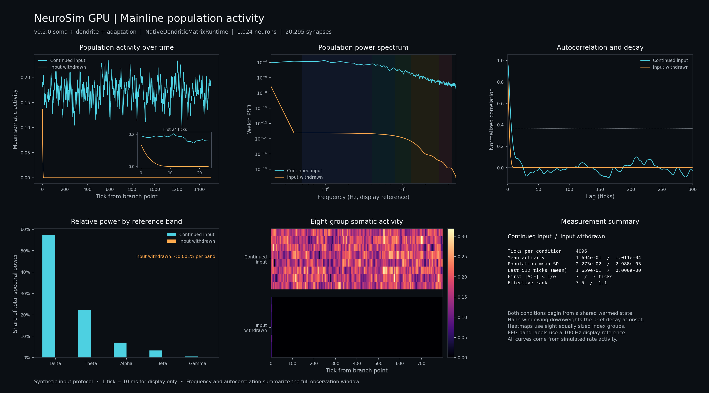

# NeuroSim GPU

[](https://github.com/zxcAsD01-d/Neurosim-GPU/actions/workflows/ci.yml)
[](LICENSE)

**English** | [中文](README.md)

**GPU-first sparse neural simulation. The development mainline is the soma–dendrite–adaptation model, with matrix/PELS propagation, fused CUDA inference and complete runtime-state checkpoints.**

Stable release: [v0.2.0](https://github.com/zxcAsD01-d/Neurosim-GPU/releases/tag/v0.2.0).
The unified CLI and reduced-precision support are available in the post-0.2.0 source checkout.

> An uncalibrated rate surrogate, not a whole-brain, spiking or ion-channel model.
> “Best mainline” means the current verified complete neural core and optimized implementations,
> not a universal speed winner. Use reference matrix as the numerical baseline and native matrix
> as the starting point for CUDA FP32 inference. Select PELS using measured activity and error.

## Recommended stack

| Layer | Implementation | Contract |
|---|---|---|
| Neuron | `DendriticDynamics` | Soma `s`, signed dendrite `d`, slow adaptation `a`; separate external drives |
| Correctness/training | `DendriticMatrixRuntime` | Differentiable CPU/CUDA reference, no thresholded propagation |
| GPU inference starting point | `NativeDendriticMatrixRuntime` | One CUDA kernel for propagation and all three states, with four weight formats |
| Event optimization | `NativeDendriticPELSRuntime` | Two kernels; explicit threshold, approximate when nonzero |
| Event reference | `DendriticPELSRuntime` | Emission/current semantics; portable propagation is not a speed guarantee |
| Recovery | Checkpoints, JSON config, fixed seed | Three states, plus PELS emitted state/current/threshold |

Point-neuron APIs (`Dynamics`, `MatrixRuntime`, etc.) remain compatible baseline and historical
experiment paths. Promoting the new model does not silently change equations or checkpoint types.

## Quick start: the complete neural core

From the current checkout, with Python ≥3.10 and PyTorch ≥2.7:

```powershell
python -m pip install -e .
python -m neurosim_gpu.simulate --steps 100 --output runs/mainline/cpu.json
```

Defaults: CPU FP32, non-thresholded matrix reference, all three compartment states.
The summary is a functional diagnostic, not a latency benchmark. CPU needs no compiler.

**CUDA inference starting point**, with CUDA PyTorch and a local build toolchain:

```powershell
scripts\native_env.bat python -m neurosim_gpu.simulate --device cuda --backend native --steps 1000 --output runs/mainline/cuda-matrix.json
scripts\native_env.bat python -m neurosim_gpu.simulate --device cuda --backend native --propagation pels --theta 0.02 --steps 1000 --output runs/mainline/cuda-pels.json
```

Use the helper on Windows; on Linux configure CUDA/C++ and run `python -m …` directly.
First use compiles the extension. Build failures are reported, not silently relabeled as native success.
Use `theta=0` for matrix parity; a nonzero threshold is not a trajectory-error bound.

**Save and resume all states**, with the same graph, model, runtime type, precision and parameters:

```powershell
python -m neurosim_gpu.simulate --steps 50 --checkpoint runs/mainline/state.pt
python -m neurosim_gpu.simulate --steps 50 --resume runs/mainline/state.pt --checkpoint runs/mainline/state.pt --output runs/mainline/resumed.json
```

With the same constant inputs this equals 100 continuous ticks. `--steps` counts this invocation's ticks.
Arbitrary external input generators, optimizers and autograd graphs are not saved.

### Python API

```python
import torch
from neurosim_gpu import Dynamics, DendriticDynamics, DendriticMatrixRuntime, random_topology

graph = random_topology(1000, 20_000, device="cpu", seed=0)
soma = Dynamics(torch.full((1000,), 0.72), torch.full((1000,), 0.8))
model = DendriticDynamics.from_time_constants(
    soma, dt=1.0, tau_dendrite=4.0, tau_adaptation=25.0,
    coupling=0.5, adaptation_strength=0.2,
)
runtime = DendriticMatrixRuntime(graph, model, torch.zeros(1, 1000))
for _ in range(100):
    state = runtime.step(drive=0.2, dendritic_drive=0.1)
print(state.shape, runtime.dendritic_state.mean().item(), runtime.adaptation_state.mean().item())
```

Use the reference API for training with `precision="fp16"`, `"fp8"`, or `"nvfp4"`. FP32 native
runtimes fall back to the reference when gradients are needed. Inspect `last_backend` to see the route.
The native compressed-weight path is for inference only.

### FP16, FP8 and NVFP4

```powershell
scripts\native_env.bat python -m neurosim_gpu.simulate --device cuda --backend native --precision nvfp4 --steps 1000
```

FP32 is the default. Native matrix inference decodes compressed weights inside the CUDA kernel
and uses FP32 multiply-adds. Reference FP16 runs CUDA Half CSR in the forward pass. FP8 and NVFP4
use quantization-aware training with dequantized FP32 sparse multiplication. All reduced-precision
paths update the three compartment states in FP32. Native PELS remains FP32.
See [execution paths, training API and benchmarks](docs/mainline.md#precision-and-benchmarks).

The [long-horizon drift probe](docs/mainline.md#long-horizon-drift) covers stable drive,
slow adaptation with input withdrawal, and sustained recurrent activity. It compares soma,
dendrite and adaptation errors against FP32 within each backend. The default protocol uses
100,000 ticks and three graph seeds; ticks are not biological milliseconds, and sampled
peaks do not bound errors between checkpoints.

## Mainline activity comparison



The v0.2.0 native CUDA matrix core warms both conditions for 512 ticks on the same graph
of 1,024 neurons and 20,295 edges. From matching three-state snapshots, it records 4,096 ticks
per condition while continuing the synthetic input or withdrawing both the soma and dendrite inputs.
Mean soma activity in the final 512 ticks was 0.16593 and 0, respectively. The frequency axis uses
a 100 Hz display convention. See the [measurements](results/compartmental_brainwaves.json)
and [reproduction steps](docs/mainline.md#activity-comparison).

## Dynamics

```text
j_t       = W @ s_t                          # W @ s_emit for PELS
d_(t+1)   = rho_d*d_t + (1-rho_d)*tanh(j_t + dendritic_drive_t)
u_t       = (1-c)*j_t + c*d_(t+1) - k*a_t
s_(t+1)   = clip(alpha*s_t + (1-alpha)*gain*tanh(u_t + drive_t), 0, 1)
a_(t+1)   = rho_a*a_t + (1-rho_a)*s_(t+1)
rho       = exp(-dt/tau)
```

All states advance every tick; only soma activity propagates. No emission means persistent current
is retained, not an automatic matrix fallback. Matrix cost is `O(BM+BN)`, storage `O(M+BN)`.
Native PELS scans `B*N` sources and traverses emitting sources' outgoing edges. Example time constants
use arbitrary consistent units, not fitted milliseconds. [Research and equations](docs/neuron-research-2026.md).

## Verified mainline performance: v0.2.0

Same dendritic model, topology, parameters and input, RTX 5070 Laptop, FP32; ms/tick:

| N | Actual M | B | Reference → native matrix | Speedup | Reference → native PELS | Speedup |
|---:|---:|---:|---:|---:|---:|---:|
| 4,096 | 65,416 | 1 | 0.284 → 0.012 | 23.84× | 0.355 → 0.021 | 17.27× |
| 50,000 | 999,787 | 1 | 0.327 → 0.063 | 5.19× | 0.423 → 0.041 | 10.20× |
| 50,000 | 999,787 | 8 | 0.671 → 0.397 | 1.69× | 0.747 → 0.184 | 4.06× |
| 166,000 | 9,998,214 | 1 | 0.769 → 0.489 | 1.57× | 0.848 → 0.347 | 2.44× |
| 166,000 | 24,988,704 | 1 | 1.444 → 1.094 | 1.32× | 1.541 → 0.964 | 1.60× |

- First profile: **29→1** matrix and **36→2** PELS kernels/tick; extra transient allocation down about **57% / 17%**.
- Matrix max absolute error: `4.47e-7–5.96e-7`. Native PELS versus same-threshold reference: `5.27e-4–5.59e-4`; versus exact matrix: about `0.00386–0.00438`. Observations, not general guarantees.
- PELS denominator is the same-model matrix-delta reference, not the older point-neuron native event kernel. No training, cross-GPU or biological-fit extrapolation.

[Protocol and report](docs/performance-0.2.0.md) · [Raw samples and source hashes](results/compartmental_performance.json).
Older point-neuron SpMM/training/50M-edge numbers stay in [historical performance](docs/performance.md),
not evidence for the new three-state model.

## Validation and reproduction

```powershell
python -m unittest discover -s tests -q
python scripts/check_links.py
$env:NEUROSIM_TEST_NATIVE="1"
scripts\native_env.bat python -m unittest discover -s tests -p test_native_compartmental.py -v
scripts\native_env.bat python benchmarks/compartmental.py --large --profile --output runs/mainline/performance.json
```

v0.2.0 release evidence: **204 CUDA/native tests passed**; memcheck and synccheck each passed
10 tests with zero errors; all PR/main CI jobs passed on Linux/Windows × Python 3.10/3.12 plus docs.
Installed-wheel native smoke, archive contents and six public asset downloads were verified.
Current mainline adds runner tests; use actual discovery counts, not retroactive release claims.
[Verification log](docs/verification.md).

## Mainline versus extensions

| Scope | Status |
|---|---|
| **Mainline core** | Three-state neurons + sparse topology + matrix/PELS + reference/native + checkpoints; [guide](docs/mainline.md) |
| Dopamine/plasticity | Chemistry, D1/D2, eligibility, weight updates, scheduler/replay exist with point-neuron runtimes; not yet unified with dendritic CUDA mainline; [API](docs/api.md) |
| Delays/development | Communication, migration, formation/pruning have separate modules/tests; not automatically included in the CLI; [architecture](docs/architecture.md) |
| MNIST/cart-pole/Gomoku | Independent task probes; historical accuracy/control results do not validate the new model; [experiments](docs/experiments.md), [results](results/REPORT.md) |
| Cortex-LM | Separate LM research, not the core default and not automatically migrated; [subproject](llm/README.md), [report](llm/REPORT.md) |

“Complete” describes the connected core workflow, not a fusion of every experimental module. Next:
jointly validate chemistry/plasticity with compartments, activity sweeps and device-side routing,
training optimization, 125M edges end to end, and task comparisons. CUDA sources already ship in
v0.2.0 wheels; that is no longer open work.

## Navigation and contributing

- [Getting started](docs/getting-started.md) · [Mainline configuration](docs/mainline.md) · [Documentation](docs/index.md)
- [Research](docs/neuron-research-2026.md) · [Native build](docs/native-build.md) · [Scope](docs/scope.md)
- `src/neurosim_gpu/`: core; `csrc/`: kernels; `benchmarks/`: measurements; `experiments/`: tasks; `llm/`: independent LM; `tests/`: regressions.
- [Contributing](CONTRIBUTING.md) · [Changelog](CHANGELOG.md) · [Citation](CITATION.cff) · [Security](SECURITY.md)

Original software that the project rights holders are entitled to license is offered under [CC BY-NC 4.0](LICENSE): attribution and noncommercial use, subject to the full license terms. Indicate modifications when sharing adapted material. Commercial uses outside the license permissions require separate written authorization. See [scope and history](LICENSING.md), [commercial licensing](COMMERCIAL.md) and [third-party notices](THIRD_PARTY_NOTICES.md). Prior grants and third-party rights remain unchanged. This is source-available software under a noncommercial license.

Unrelated to [grasp-lyrl/neurosim](https://github.com/grasp-lyrl/neurosim)
and [neurosim/neurosim](https://github.com/neurosim/neurosim); no performance ranking against them is claimed.
