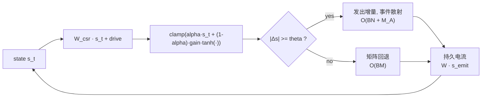

# NeuroSim GPU

[](https://github.com/zxcAsD01-d/Neurosim-GPU/actions/workflows/ci.yml)
[](LICENSE)

**中文** | [English](README.en.md)

GPU 优先的稀疏神经仿真：固定拓扑神经核（`N` 个神经元、`M` 条突触），一个 tick
就是一次稀疏矩阵乘法加少量向量运算，并在其上叠加持久突触电流（PELS）事件传播、
区域多巴胺化学、资格迹可塑性与多速率调度。

```text
synaptic_current = W_csr @ state
state = clamp(alpha * state + (1 - alpha) * gain * tanh(current + drive))
```

时间 `O(BM + BN)`，内存 `O(M + BN)`。化学、延迟、资格迹与结构发育各有独立状态、
节奏与成本记录。

> **研究原型**：功能性仿真栈，不是经过生物学验证的脑模型。引用前请读
> [docs/scope.md](docs/scope.md)。

## 概览

| | |
|---|---|
| 运行时 | 可移植矩阵 · 持久电流（PELS） · 融合 CUDA 矩阵 · 融合 CUDA 事件 |
| 回归测试 | 174 个（无 CUDA 跳过 1 个；无 transformers 跳过 11 个） |
| 依赖 | 仅 PyTorch ≥ 2.7（`cortex` 的 HF 路径需可选 `transformers`） |
| Python | 3.10 – 3.13 |
| 许可 | Apache-2.0 |
| tick 成本 | 10–50M 边时为同参数 cuSPARSE 层的 0.74–0.82×（GPU） |
| 状态 | v0.1.0 研究原型 |

## 快速开始

```powershell
python -m pip install -e .
python -m unittest discover -s tests -q     # 174 个测试
```

第一个 tick（纯 CPU 即可）：

```python
import torch
from neurosim_gpu import Dynamics, MatrixRuntime, random_topology

topology = random_topology(1000, 20_000, device="cpu", seed=0)
dynamics = Dynamics(
    alpha=torch.full((1000,), 0.72),
    gain=torch.full((1000,), 1.05),
)
runtime = MatrixRuntime(topology, dynamics, torch.zeros(1, 1000))
for _ in range(10):
    state = runtime.step(drive=0.1)
print(topology.n_edges, float(state.mean()))
```

更多：[上手指南](docs/getting-started.md) · [可运行 API](docs/api.md)。

## 工作原理



多速率归属：

```text
每 tick：        神经动力学 · 延迟通信 · 迹/资格
每 K_c tick：    区域化学 · 受体缓存 · 可选权重更新
每 K_m tick：    迁移 / 区域重映射
每 K_s tick：    候选打分 · 生成/修剪 · 拓扑重建
```

原生内核需要 CUDA 版 PyTorch，首次调用时编译，见[原生构建](docs/native-build.md)。
注意：启用 eligibility 时多巴胺运行时每个 tick 仍扫描全部 `M` 条边。

## 性能

核心主张只有一句话：**一个完整神经 tick 的成本约等于一次同规模稀疏矩阵乘法。**

| N | M | batch | 完整神经 tick | 对比 cuSPARSE 原始 SpMM | 对比同参数自研 SpMM |
|---:|---:|---:|---:|---:|---:|
| 166k | 10.00M | 1 | 0.595 ms | **0.82×** | 1.07× |
| 166k | 24.99M | 1 | 1.350 ms | **0.74×** | 1.03× |
| 166k | 49.95M | 1 | 2.466 ms | **0.75×** | 0.92× |
| 50k | 1.00M | 8 | 0.513 ms | 1.15× | 1.12× |

RTX 5070 Laptop、CUDA 13.1、FP32，warmup 后取中位数。神经更新（tanh、leak、gain、
clip）只比同参数自研 SpMM 多 2.8–6.6%；batch=1 时融合 tick 反而快于 cuSPARSE
分母，因为它把 cuSPARSE 无法融合的部分做在了同一个核里。

- **事件稀疏**：`theta=0.05`、约 2.64% 的边发射时，原生事件核比矩阵 tick 快
  **3.0–4.5×**（10M 边：0.200 ms vs 0.595 ms）。
- **训练**：前向+反向是同参数稀疏 RNN 的 **1.075×**（93% 效率，原生逐点 adjoint）；
  还差的是整段 rollout 的融合 adjoint。
- **内存**：可变拓扑 24 B/突触，只读视图约 16 B/突触；125M 边外推为 3.0 GB /
  2.0 GB。**125M 这个点本身尚未端到端跑过。**
- **CPU 参考基线**（无需 GPU）：tick 仍是原始稀疏乘法的 1.18–1.82×，但 Python
  事件散射比稠密路径慢 5–80×——事件稀疏是原生内核的性质，不是参考路径的。

完整表格、方法论、成本模型与复现命令见[docs/performance.md](docs/performance.md)；
带硬件的正式 GPU 数字见[docs/results.md](docs/results.md)。

### 真实任务上的验证

这些探针验证"能不能学会/控制"，不是性能测量（详见[docs/experiments.md](docs/experiments.md)
与 [results/REPORT.md](results/REPORT.md)）：

| 实验 | 结果 |
|---|---|
| **MNIST：本仓库模型（全量 60k 训练 / 10k 测试）** | **99.58%**（5 种子 + TTA；单模型 99.55%，10,000 张错 42 张） |
| MNIST：稀疏核路线（4,585 → 10,852 个可训练标量） | 91.1% → 96.4% |
| MNIST：稀疏脑 vs 同参数 MLP | 91.1% vs 87.3%（4,585 个可训练标量） |
| MNIST：稀疏脑 vs 逻辑回归 | 91.1% vs 91.8%——精度上没有优势 |
| MNIST 高斯噪声 σ=0.3 | 72.9% vs 55.1%（宽 MLP）——稀疏核更抗噪 |
| 倒立摆：行为克隆 | MLP 与稀疏脑都是 200/200 步；只有极端延迟/噪声才失败 |
| 执行器突变下的在线三因子可塑性 | 无可测量收益；消融显示学到的递归权重近乎可省 |

> MNIST 最优结果由 `experiments/mnist_optimized.py` 产出，细节与复现命令见
> [results/MNIST_OPTIMIZATION_RESULTS.md](results/MNIST_OPTIMIZATION_RESULTS.md)。

### Cortex-LM：Qwen3 3+2 × 神经元中段

Qwen3-0.6B 的 28 层只保留前 3 层和后 2 层，中间 23 层删除，换成一个
1024 神经元的稠密递归核；Qwen3 保留的全部权重冻结，只训练中段。中段的
递归矩阵用被删 23 层的**线性化残差映射**初始化（`o@v + down@up` 组合），
不是随机初始化。

```text
tokens → [embedding + 前 3 层] → [1024 神经元, W 1024×1024] → [后 2 层 + LM head]
```


**状态：3+2、移植、20k 长训练、开环读出、空间/损失驱动重连、时序记忆、生物
启发记忆和开环一致性训练已完成。** 20k 步 eval ppl **22.69**，能写通顺中文
句子，但采样仍会跑题，**不能算会对话**。stage3 用短时突触资源、eligibility、
多巴胺巩固和 homeostatic scaling，同配置 8-batch ppl **21.49**，比 stage2 的
22.31 好约 3.7%，但仍未超过 dense 的 20.46；脑有效秩从 52.8 拉回 **56.5**，
仍低于 dense 的 60.9。stage4 一次性加 8 步零 drive 开环损失，ppl 反而退化到
**22.15**，辅助 loss 11.6→10.9 几乎不降。结论：生物启发方向有正信号，但
长期记忆和开环解码都没解决。详见 [完整报告](llm/REPORT.md) 与
[技术记录](llm/docs/cortex-lm.md)。

```powershell
$env:PYTHONPATH="src"
.\.venv-str\Scripts\python.exe -m neurosim_gpu.cortex.train `
  --config llm/configs/cortex_qwen3_3p2_minimind.json --dry-run --device cuda `
  --set backbone.model_id=data/qwen3_06b `
  --set backbone.tokenizer_id=data/qwen3_06b `
  --set backbone.local_files_only=true
```

## 可复现与数据

| 路径 | 内容 |
|---|---|
| [`results/raw/`](results/raw) | 182 份 JSON 载荷（105 次网格 + 77 次探索），含配置、指标、训练历史、逐条件结果 |
| [`results/summary_*.csv`](results) | 每个套件的宽表，一行一次运行 |
| [`results/TABLES.md`](results/TABLES.md) | 由原始载荷聚合出的全部数据表 |
| [`results/REPORT.md`](results/REPORT.md) | 方法、结果、失败记录与局限 |
| [`docs/verification.md`](docs/verification.md) | 发布验证记录 |

```powershell
python experiments/analyze.py                 # 从 results/raw 重建 TABLES.md
python experiments/run_suite.py --list        # 12 个套件的网格
python experiments/run_suite.py --suite all   # 重跑（CPU 约 40 分钟）
```

MNIST 语料**不入库**：首次使用时下载官方 idx 文件并缓存在 `data/mnist/`
（已 gitignore）；checkpoint 是缓存，同样忽略。精度与生存步数由种子确定，
延迟不确定。

## 目录结构

```text
src/neurosim_gpu/   包：运行时、拓扑、化学、多巴胺、调度器……
llm/                Cortex-LM 子项目：源码、配置、脚本、报告、结果图
csrc/               CUDA/C++ 扩展源码（按需编译）
benchmarks/         GPU、成本模型、延迟、训练对齐、五子棋探针
experiments/        MNIST 与倒立摆实验套件
tests/              回归测试
docs/               契约、测量与指南
scripts/            原生构建助手、文档链接检查
results/            报告、聚合表、原始载荷
```

## 文档

从 [docs/index.md](docs/index.md) 开始（含阅读路径与文档权威表）：

| 文档 | 内容 |
|---|---|
| [上手指南](docs/getting-started.md) | 安装、第一个 tick、常见问题 |
| [API](docs/api.md) | 公共工作流、张量契约、错误 |
| [设计](docs/design.md) · [架构](docs/architecture.md) | 数值契约、状态归属、运行时模式 |
| [生物学语义](docs/biology.md) | 模型代表什么、类比在哪里停止 |
| [成本模型](docs/efficiency.md) · [结果](docs/results.md) · [验证](docs/validation.md) | 成本公式、已测数字、验收标准 |
| [实验](docs/experiments.md) · [五子棋协议](docs/gomoku-protocol.md) | 任务级实验与协议 |
| [状态](docs/status.md) · [发布验证](docs/verification.md) | 里程碑记分卡、验证记录 |
| [技术报告](paper/main.pdf) | 成本归一化评估论文；LaTeX 源码与生成脚本在 paper/ |

## 边界声明

本项目是研究原型，不主张生物真实性、全脑规模或自博弈强度；所有性能数字都与记录的
硬件和图规模绑定。CPU 结果说明的是正确性与参数效率，不是吞吐。详见
[docs/scope.md](docs/scope.md)。

## 我们主张什么（可被反驳）

一句话版本：

> 在 GPU 上，固定拓扑稀疏神经模拟器可以把神经状态更新的额外开销压到同规模稀疏乘法的几个百分点，并在低活动率下用原生事件传播显著降低 tick 成本。

完整账本在 [docs/claims.md](docs/claims.md)：每条主张的证据、状态（支持 / 部分 / 未验证 / 已反驳），以及什么结果会推翻它。其中三条仍未完成：125M 边端到端、活动率扫描与自动选路、与成熟模拟器的同任务对照。

## 与同名项目的关系

本项目与以下两个同名项目**无关**，问题定义也不同：

- [grasp-lyrl/neurosim](https://github.com/grasp-lyrl/neurosim)：神经形态机器人感知模拟器；
- [neurosim/neurosim](https://github.com/neurosim/neurosim)：存内计算硬件评估框架。

NeuroSim-GPU 研究固定拓扑稀疏率动力学、持久突触电流事件传播与区域神经化学的成本/精度权衡，不与上述项目做性能排名。
## 路线图

- 跑通 125M 边的预构建拓扑端到端实验；
- 用设备端选择器替代矩阵/事件策略，去掉主机同步；
- 用整段 rollout 的自定义 adjoint 把训练对齐从 1.075× 降到 ≤ 1.05×；
- 把 `csrc/` 打包进 wheel，让 `pip install` 用户也能编译内核；
- 设计能让事件路径保持稀疏的 eligibility 表示。

## 贡献与许可

欢迎贡献，请先读 [CONTRIBUTING.md](CONTRIBUTING.md) 与[验证标准](docs/validation.md)；
提交前保证测试全绿、文档链接可解析（`python scripts/check_links.py`）。

采用 Apache License 2.0，见 [LICENSE](LICENSE)；引用信息见 [CITATION.cff](CITATION.cff)，
变更记录见 [CHANGELOG.md](CHANGELOG.md)。安全问题请按 [SECURITY.md](SECURITY.md) 私下报告。

## 常见问题

**必须要 GPU 吗？** 不需要。所有可移植路径都能在 CPU 上跑，只有原生融合内核需要 CUDA。

**能用我自己的连接组吗？** 可以。用 `SparseTopology.from_edges` 构造，或用
`load_topology` 载入；重复边会被合并。

**为什么 CPU 上稀疏路径比稠密 MLP 慢？** 几千条边时，每 tick 的 Python 调度与 CSR
重建开销占主导；稀疏优势出现在更大的 `M` 且活动很低时，或使用原生内核时——
见[docs/experiments.md](docs/experiments.md)。

**多巴胺部分是生物学模型吗？** 是功能性代理：tonic/burst/dip、D1/D2 占用与三因子
可塑性都已实现并测试，但没有用实验数据校准，见[docs/biology.md](docs/biology.md)。
