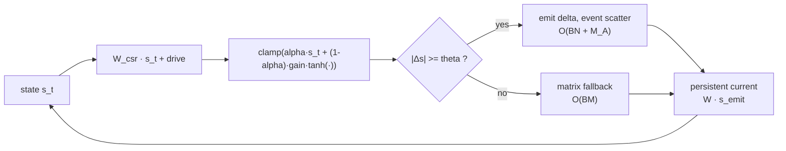

# NeuroSim GPU

[](https://github.com/zxcAsD01-d/Neurosim-GPU/actions/workflows/ci.yml)
[](LICENSE)
[](pyproject.toml)

GPU-first sparse neural simulation. A fixed-topology neural core — `N` neurons,
`M` synapses — whose tick is one sparse matrix multiplication plus a few vector
operations, extended with persistent-current event propagation, regional dopamine
chemistry, eligibility-based plasticity and a multi-rate scheduler.

```text
synaptic_current = W_csr @ state
state = clamp(alpha * state + (1 - alpha) * gain * tanh(current + drive))
```

`O(BM + BN)` time and `O(M + BN)` memory per tick. Chemistry, delays,
eligibility and structural development run at their own cadence with their own
state and documented cost.

> **Research prototype.** A functional simulation stack, not a biologically
> validated brain model. Read [docs/scope.md](docs/scope.md) before citing it.

## At a glance

| | |
|---|---|
| Runtimes | portable matrix · persistent current (PELS) · native fused matrix · native event |
| Regression tests | 107 (1 CUDA-only test skipped on CPU) |
| Dependencies | PyTorch ≥ 2.7, nothing else |
| Python | 3.10 – 3.13 |
| License | Apache-2.0 |
| Status | v0.1.0 research prototype |

## Quick start

```powershell
python -m pip install -e .
python -m unittest discover -s tests -q     # 107 tests
```

A first tick — CPU is enough:

```python
import torch
from neurosim_gpu import Dynamics, MatrixRuntime, random_topology

topology = random_topology(1000, 20_000, device="cpu", seed=0)
dynamics = Dynamics(
    alpha=torch.full((1000,), 0.72),
    gain=torch.full((1000,), 1.05),
)
runtime = MatrixRuntime(topology, dynamics, torch.zeros(1, 1000))
for _ in range(10):
    state = runtime.step(drive=0.1)
print(topology.n_edges, float(state.mean()))
```

More: [getting started](docs/getting-started.md) ·
[runnable API workflows](docs/api.md).

## How it works



Multi-rate ownership:

```text
every tick:        neural dynamics · delayed communication · traces/eligibility
every K_c ticks:   regional chemistry · receptor cache · optional weight update
every K_m ticks:   migration / region remapping
every K_s ticks:   candidate scoring · formation/pruning · topology rebuild
```

| Runtime | Path | Notes |
|---|---|---|
| `MatrixRuntime`, `DopamineMatrixRuntime` | portable PyTorch CSR | readable reference, portable |
| `HybridPELSRuntime`, `DopaminePersistentRuntime` | persistent synaptic current | propagates emitted deltas; the reference scatter is still a full SpMM |
| `NativeCanonicalMatrixRuntime`, `NativeDopamineMatrixRuntime` | fused CUDA | destination-major reduction over one weight array |
| `NativeEventPELSRuntime`, `DopamineEventRuntime` | fused CUDA event path | `O(BN + M_A)` propagation at low activity |

Native kernels need a CUDA build of PyTorch and compile on first use:
[native build](docs/native-build.md). With eligibility enabled, the dopamine
runtime still scans all `M` edges per tick — whole-tick event sparsity requires
eligibility disabled and no weight update on that tick.

## What has been measured

Accepted numbers (hardware, graph size and command recorded with each) are in
[docs/results.md](docs/results.md); their interpretation is
[docs/efficiency.md](docs/efficiency.md).

- fixed-core forward at batch 1: **0.74–0.82×** the cost of a same-parameter
  sparse kernel at 10–25M edges;
- low-activity event propagation: **3–4.5×** faster than the matrix path near
  2.6% active edges;
- MNIST emitted-event threshold: **21% of edges active, −0.12 accuracy points**
  (forward pass only).

Task-level probes ([docs/experiments.md](docs/experiments.md), full report in
[results/REPORT.md](results/REPORT.md)):

| Probe | Result |
|---|---|
| MNIST, sparse brain vs parameter-matched MLP | 91.1% vs 87.3% (4,585 trainable scalars) |
| MNIST, sparse brain vs logistic regression | 91.1% vs 91.8% — no accuracy win |
| MNIST under Gaussian noise σ=0.3 | 72.9% vs 55.1% (wide MLP) — sparse core is more noise-robust |
| Inverted pendulum, behaviour cloning | 200/200 steps for both MLP and sparse brain; failures only under extreme delay/noise |
| Online three-factor plasticity after a plant change | no measurable benefit; ablation shows the learned recurrence is nearly dispensable |

## Reproducibility and data

Everything needed to re-derive the tables is in the repository:

| Path | Contents |
|---|---|
| [`results/raw/`](results/raw) | 182 JSON payloads (105 grid runs + 77 exploratory runs): config, metrics, history, per-condition rows |
| [`results/summary_*.csv`](results) | one row per run, per suite |
| [`results/TABLES.md`](results/TABLES.md) | aggregate tables generated from the raw payloads |
| [`results/REPORT.md`](results/REPORT.md) | methodology, results, failure log, limitations |
| [`docs/verification.md`](docs/verification.md) | release verification log (what ran, on which stack, what passed) |

```powershell
python experiments/analyze.py                 # rebuild results/TABLES.md from results/raw
python experiments/run_suite.py --list        # the 12-suite grid
python experiments/run_suite.py --suite all   # re-run it (~40 min on CPU)
```

The MNIST corpus is **not** committed: the official idx files are downloaded on
first use and cached under `data/mnist/` (git-ignored). Checkpoints are caches
and are ignored as well. Accuracy and survival metrics are seed-deterministic;
latency is not.

## Repository layout

```text
src/neurosim_gpu/   package: runtime, topology, chemistry, dopamine, scheduler, ...
csrc/               CUDA/C++ extension sources (built on demand)
benchmarks/         GPU, cost model, latency, training parity, Gomoku probes
experiments/        MNIST and inverted-pendulum experiment suite
tests/              regression suite
docs/               contracts, measurements and guides
scripts/            native build helper, documentation link check
results/            report, aggregate tables, raw payloads
```

## Documentation

Start at [docs/index.md](docs/index.md). The short version:

| Document | Contents |
|---|---|
| [getting-started](docs/getting-started.md) | install, first tick, troubleshooting |
| [api](docs/api.md) | public workflows, tensor contracts, errors |
| [design](docs/design.md) · [architecture](docs/architecture.md) | numerical contract, state ownership, runtime modes |
| [biology](docs/biology.md) | what the neurochemical model means and where the analogy stops |
| [efficiency](docs/efficiency.md) · [results](docs/results.md) · [validation](docs/validation.md) | cost model, accepted measurements, acceptance criteria |
| [experiments](docs/experiments.md) · [gomoku-protocol](docs/gomoku-protocol.md) | task-level probes and protocols |
| [status](docs/status.md) · [verification](docs/verification.md) | milestone scorecard, release verification log |

中文简介见 [README.zh-CN.md](README.zh-CN.md)。

## Scope

This is a research prototype. It does not claim biological realism, whole-brain
scale or self-play strength; its performance numbers are bound to the hardware
and graph size recorded with them, and CPU results are about correctness and
parameter efficiency rather than throughput. See [docs/scope.md](docs/scope.md).

## Roadmap

- Execute the 125M-edge prebuilt-topology point end to end.
- Replace the matrix/event policy with a device-side selector that needs no
  host synchronisation.
- Move training parity from 1.075× to ≤ 1.05× with a whole-rollout custom adjoint.
- Ship `csrc/` inside the wheel so `pip install` users can build the kernels.
- Design an eligibility representation that keeps the event path sparse.

## Contributing and license

Contributions are welcome; start with [CONTRIBUTING.md](CONTRIBUTING.md) and the
acceptance criteria in [docs/validation.md](docs/validation.md). The suite must
stay green and documentation links must resolve
(`python scripts/check_links.py`).

Licensed under the Apache License 2.0 — see [LICENSE](LICENSE). Citation metadata
is in [CITATION.cff](CITATION.cff); release notes are in
[CHANGELOG.md](CHANGELOG.md).

## FAQ

**Do I need a GPU?** No. Every portable path runs on CPU; only the native fused
kernels require CUDA.

**Can I use my own connectome?** Yes. Build a `SparseTopology` with
`SparseTopology.from_edges`, or load one with `load_topology`; duplicate edges
are coalesced.

**Why is the sparse path slower than a dense MLP on CPU?** At a few thousand
edges, per-tick Python and CSR-construction overhead dominates. The sparse
advantage appears at larger `M` with low activity, or with the native kernels —
see [docs/experiments.md](docs/experiments.md).

**Is the dopamine subsystem a biological model?** It is a functional proxy:
tonic/burst/dip chemistry, D1/D2 occupancy and three-factor plasticity are
implemented and tested, but not calibrated to recordings. See
[docs/biology.md](docs/biology.md).
