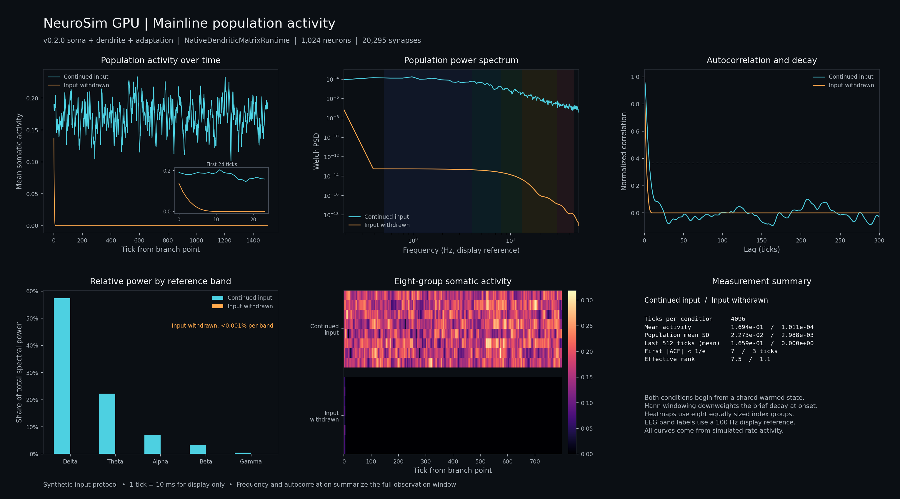

# NeuroSim GPU

[](https://github.com/zxcAsD01-d/Neurosim-GPU/actions/workflows/ci.yml)
[](LICENSE)

**中文** | [English](README.en.md)

**GPU 优先的稀疏神经仿真。当前开发主线：胞体＋树突分区＋慢适应，配套矩阵/PELS 传播、融合 CUDA 推理与完整运行时状态恢复。**

稳定版本：[v0.2.0](https://github.com/zxcAsD01-d/Neurosim-GPU/releases/tag/v0.2.0)。
统一命令行入口和低精度支持随 v0.2.0 之后的主线源码提供。请安装当前源码 checkout。

> 未经生物数据拟合的速率代理模型，不是全脑、脉冲或多离子通道仿真。
> “最优主线”指优先采用当前已验证的完整神经核与优化实现，不意味着所有硬件、图、
> 活动率和任务上都最快。参考矩阵是数值基准，原生矩阵是 CUDA FP32 推理的首选起点；
> PELS 必须结合误差与活动率实测选择。

## 主线包含什么

| 层次 | 当前推荐 | 契约 |
|---|---|---|
| 神经元 | `DendriticDynamics` | 胞体 `s`、有符号树突 `d`、慢适应 `a`，独立胞体/树突输入 |
| 正确性与训练 | `DendriticMatrixRuntime` | CPU/CUDA 可微参考，不丢弃传播增量 |
| GPU 推理起点 | `NativeDendriticMatrixRuntime` | 单次 CUDA kernel 完成传播和三状态更新，支持四种权重精度 |
| 事件优化 | `NativeDendriticPELSRuntime` | 两次 kernel；显式阈值，非零阈值是近似路径 |
| 事件参考 | `DendriticPELSRuntime` | 核对发射状态与持久电流；参考传播不保证事件加速 |
| 恢复与复现 | checkpoint、JSON 配置、固定 seed | 保存三状态；PELS 额外保存发射状态、电流与阈值 |

旧 `Dynamics` / `MatrixRuntime` 等点神经元 API 保持兼容，作为基线和历史实验入口，
不再是首页推荐模型。没有静默改变现有用户的方程或 checkpoint 类型。

## 快速开始：直接运行完整神经核

在当前源码 checkout 安装（仅依赖 Python ≥3.10、PyTorch ≥2.7）：

```powershell
python -m pip install -e .
python -m neurosim_gpu.simulate --steps 100 --output runs/mainline/cpu.json
```

默认 CPU、FP32、精确传播的树突矩阵参考，输出胞体/树突/适应三组状态统计。
CPU 不需要编译器；该摘要不是性能基准。

**CUDA 推理推荐起点**（需 CUDA 版 PyTorch 和本地编译工具链）：

```powershell
scripts\native_env.bat python -m neurosim_gpu.simulate --device cuda --backend native --steps 1000 --output runs/mainline/cuda-matrix.json
scripts\native_env.bat python -m neurosim_gpu.simulate --device cuda --backend native --propagation pels --theta 0.02 --steps 1000 --output runs/mainline/cuda-pels.json
```

Windows 用工具链助手；Linux 配好 CUDA/C++ 环境后直接运行 `python -m …`。
首次 native 调用会 JIT 编译；构建失败明确报错，不会伪装为 native 成功。
`theta=0` 用于与矩阵核对；`theta>0` 不能解释为轨迹误差上界。

**完整状态保存和接续**（相同图、模型、运行时类型、精度及参数）：

```powershell
python -m neurosim_gpu.simulate --steps 50 --checkpoint runs/mainline/state.pt
python -m neurosim_gpu.simulate --steps 50 --resume runs/mainline/state.pt --checkpoint runs/mainline/state.pt --output runs/mainline/resumed.json
```

相同恒定输入下等价于连续执行 100 ticks；`--steps` 是本次执行步数。
checkpoint 不保存任意外部输入发生器、训练优化器或梯度图。

### Python API

```python
import torch
from neurosim_gpu import Dynamics, DendriticDynamics, DendriticMatrixRuntime, random_topology

graph = random_topology(1000, 20_000, device="cpu", seed=0)
soma = Dynamics(torch.full((1000,), 0.72), torch.full((1000,), 0.8))
model = DendriticDynamics.from_time_constants(
    soma, dt=1.0, tau_dendrite=4.0, tau_adaptation=25.0,
    coupling=0.5, adaptation_strength=0.2,
)
runtime = DendriticMatrixRuntime(graph, model, torch.zeros(1, 1000))
for _ in range(100):
    state = runtime.step(drive=0.2, dendritic_drive=0.1)
print(state.shape, runtime.dendritic_state.mean().item(), runtime.adaptation_state.mean().item())
```

用参考运行时训练，可传入 `precision="fp16"`、`"fp8"` 或 `"nvfp4"`。原生 FP32
运行时需要梯度时会回退到参考实现，可用 `last_backend` 检查。原生压缩权重路径仅用于推理。

### FP16、FP8 与 NVFP4

```powershell
scripts\native_env.bat python -m neurosim_gpu.simulate --device cuda --backend native --precision nvfp4 --steps 1000
```

FP32 仍为默认。原生矩阵在 CUDA 核内解码压缩权重，使用 FP32 乘加。参考 FP16 使用 CUDA
Half CSR 前向，FP8 和 NVFP4 使用量化感知训练，量化后解码为 FP32 执行稀疏乘法。
各低精度路径都以 FP32 更新胞体、树突和慢适应状态。原生 PELS 仍使用 FP32。
执行路径、训练 API、实测速度和显存见[精度与测速](docs/mainline.md#precision-and-benchmarks)。

低精度的[长时程漂移核验](docs/mainline.md#long-horizon-drift)覆盖稳定驱动、慢适应撤除输入和
持续递归活动三个场景，以同后端 FP32 为基准，分别检查胞体、树突与适应状态。默认协议为
100,000 tick、三个图种子；tick 不代表生物毫秒，采样峰值也不是逐步误差上界。

## 主线仿真对照



采用 v0.2.0 的 CUDA 原生矩阵内核，在同一张含 1,024 个神经元、20,295 条边的图上预热 512 步，
再从相同的三状态出发，分别持续施加合成输入和同时撤去胞体与树突输入，各记录 4,096 步。
最后 512 步的平均胞体活动分别为 0.16593 和 0。图中的 100 Hz 仅用于频轴显示换算。
见[原始测量](results/compartmental_brainwaves.json)和[复现步骤](docs/mainline.md#activity-comparison)。

## 模型与数值语义

```text
j_t       = W @ s_t                          # PELS 为 W @ s_emit
d_(t+1)   = rho_d*d_t + (1-rho_d)*tanh(j_t + dendritic_drive_t)
u_t       = (1-c)*j_t + c*d_(t+1) - k*a_t
s_(t+1)   = clip(alpha*s_t + (1-alpha)*gain*tanh(u_t + drive_t), 0, 1)
a_(t+1)   = rho_a*a_t + (1-rho_a)*s_(t+1)
rho       = exp(-dt/tau)
```

三状态每 tick 都更新，只有胞体通过突触传播。PELS 无发射时**保持**持久电流，
不是因为单个神经元低于阈值就自动切换矩阵。矩阵复杂度 `O(BM+BN)`，内存
`O(M+BN)`；原生事件传播访问发射源出边，仍扫描 `B*N` 个源。
`dt/tau` 使用同一任意单位，示例值不是实验校准值。

文献、更新顺序与限制：[近期研究与神经元模型](docs/neuron-research-2026.md)。

## 已验证的主线性能：v0.2.0

相同树突模型、拓扑、参数与输入，RTX 5070 Laptop，FP32。单位 ms/tick：

| N | 实际 M | B | 参考矩阵 → 原生矩阵 | 加速 | 参考 PELS → 原生 PELS | 加速 |
|---:|---:|---:|---:|---:|---:|---:|
| 4,096 | 65,416 | 1 | 0.284 → 0.012 | 23.84× | 0.355 → 0.021 | 17.27× |
| 50,000 | 999,787 | 1 | 0.327 → 0.063 | 5.19× | 0.423 → 0.041 | 10.20× |
| 50,000 | 999,787 | 8 | 0.671 → 0.397 | 1.69× | 0.747 → 0.184 | 4.06× |
| 166,000 | 9,998,214 | 1 | 0.769 → 0.489 | 1.57× | 0.848 → 0.347 | 2.44× |
| 166,000 | 24,988,704 | 1 | 1.444 → 1.094 | 1.32× | 1.541 → 0.964 | 1.60× |

- 第一组 profiler：矩阵 **29→1**、PELS **36→2** kernel/tick；瞬时额外分配约减少 **57% / 17%**。
- 矩阵最大绝对误差 `4.47e-7–5.96e-7`；非零阈值原生 PELS 对同阈值参考为 `5.27e-4–5.59e-4`，对精确矩阵约 `0.00386–0.00438`。均为观测值，不是一般保证。
- PELS 分母是矩阵增量传播的同模型参考，不是旧点神经元 native event。没有外推训练速度、其他 GPU 或生物拟合质量。

[性能报告](docs/performance-0.2.0.md) · [原始样本与源码 SHA256](results/compartmental_performance.json)。
旧点神经元的 cuSPARSE、训练和 50M 边数据留在[历史报告](docs/performance.md)，
不能当作新三状态模型的测量。

## 验证与复现

```powershell
python -m unittest discover -s tests -q
python scripts/check_links.py
$env:NEUROSIM_TEST_NATIVE="1"
scripts\native_env.bat python -m unittest discover -s tests -p test_native_compartmental.py -v
scripts\native_env.bat python benchmarks/compartmental.py --large --profile --output runs/mainline/performance.json
```

v0.2.0 发布记录：**204 项 CUDA/native 测试通过**，memcheck / synccheck 各 10 项且
0 errors，PR/main 的 Linux/Windows × Python 3.10/3.12 与文档 CI 通过；wheel
编译 smoke、源码包和 6 个公开附件下载校验通过。当前 checkout 另有统一入口回归测试；
以实际 discovery 数量为准，不将新增测试冒充旧发布结果。见[验证记录](docs/verification.md)。

## 主线、扩展与历史实验的边界

| 范围 | 状态与入口 |
|---|---|
| **主线基础仿真** | 三状态神经元 + 稀疏拓扑 + 矩阵/PELS + reference/native + checkpoint；[主线指南](docs/mainline.md) |
| 多巴胺与可塑性 | 区域化学、D1/D2、资格迹、权重更新、调度/重放在已有点神经元运行时实现；尚未和树突 CUDA 主线统一，见 [API](docs/api.md) |
| 延迟与结构发育 | 通信、迁移、候选连边/修剪有独立模块和测试；不自动包含在主线 CLI，见 [架构](docs/architecture.md) |
| MNIST、倒立摆、五子棋 | 独立任务探针；历史精度/控制结果不是新模型的任务验证，见 [实验](docs/experiments.md) 与 [结果](results/REPORT.md) |
| Cortex-LM | 独立语言模型研究，不作为基础仿真默认入口；未自动迁移到树突模型，见 [子项目](llm/README.md) 与 [报告](llm/REPORT.md) |

“完整”限于上述已接通的基础神经仿真闭环，不是所有实验模块都已融合。后续主线重点：
联合化学/可塑性与树突核、活动率扫描与设备端选路、训练优化、125M 边端到端和任务对照。
CUDA 源码已随 v0.2.0 wheel 打包，不再列为未完成项。

## 导航与贡献

- [上手](docs/getting-started.md) · [主线配置与选路](docs/mainline.md) · [全部文档](docs/index.md)
- [研究与方程](docs/neuron-research-2026.md) · [原生构建](docs/native-build.md) · [范围](docs/scope.md)
- `src/neurosim_gpu/` 核心包；`csrc/` 原生核；`benchmarks/` 测量；`experiments/` 任务；`llm/` 独立语言模型；`tests/` 回归。
- [贡献指南](CONTRIBUTING.md) · [变更记录](CHANGELOG.md) · [引用](CITATION.cff) · [安全报告](SECURITY.md)

Apache-2.0，见 [LICENSE](LICENSE)。本仓库与 [grasp-lyrl/neurosim](https://github.com/grasp-lyrl/neurosim)
和 [neurosim/neurosim](https://github.com/neurosim/neurosim) 无关，不与其做性能排名。
