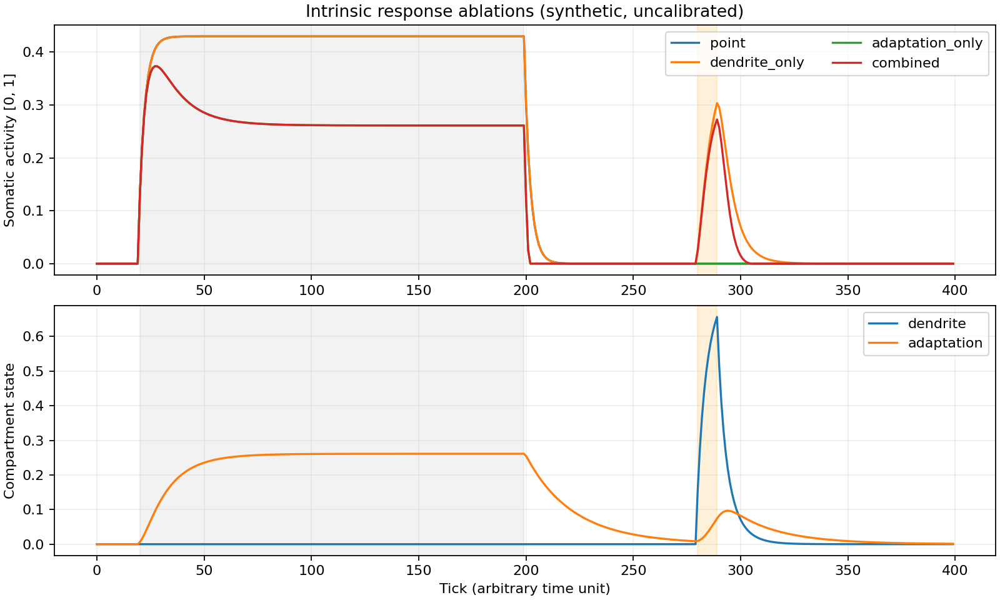

# 近期神经元研究与基础模型更新

检索截止 **2026-11-17（Asia/Shanghai）**。范围是与本项目 GPU 稀疏神经仿真
直接相关的树突计算、细胞内时间尺度及适应；这是一份针对实现的文献筛选，
不是神经科学全领域的系统综述。日期采用论文首次在线发表/预印本日期，
而非搜索引擎抓取时间。书目信息与作者摘要通过 Europe PMC 核对，DOI 指向原文。

## 文献与取舍

| 日期、文献 | 证据与结论 | 对本次实现的影响 |
|---|---|---|
| 2026-11-12，Trubitsin，*Signal propagation and separation in a self-organized three-dimensional neural network with activity-dependent conduction*，[预印本](https://doi.org/10.21203/rs.3.rs-11535023/v1) | 自组织网络计算研究，把传导延迟与突触传递联系到轴突/树突几何、活动及短时抑制。未同行评审。 | 纳入近期研究记录；本次不改变延迟、髓鞘或空间拓扑。 |
| 2026-11-05，Lagzi 等，*Dendrite Control Theory: A Unifying Framework Bridging Neuronal Morphology And Dendritic Voltage Behavior*，[预印本](https://doi.org/10.64898/2026.11.04.764328) | 用控制理论研究形态与输入位置对树突电压可控性、韧性和能量代价的约束。未同行评审。 | 提醒单树突分区不能替代形态模型；本次不宣称得到形态、能耗或可控性结果。 |
| 2026-10-15，Zhang 等，*Dendritic computation for abstract rule-based flexible decision-making*，Science，[原文](https://doi.org/10.1126/science.adz5323) | 小鼠任务、双光子成像与光遗传实验：听觉皮层 L5 神经元的顶树突更偏向编码抽象规则，胞体更偏向感觉刺激；树突干预影响规则相关选择编码。 | 为分别提供 `drive` 与 `dendritic_drive` 提供生物学动机。本实现没有规则学习或光遗传实验的复现。 |
| 2026-10-15，Yao 等，*Dendritic computation bridges neuroscience and foundation models*，Nature Communications，[原文](https://doi.org/10.1038/s41467-026-77929-8) | 研究简化树突模型与注意力机制的映射，并构建受树突启发的基础模型。 | 支持探索细胞内计算；本次只更新基础仿真，不移植论文注意力架构，也不继承其长上下文结果。 |
| 2026-08-21，Onasch 等，*Assembly-based computations through contextual dendritic gating of plasticity*，Neuron，[原文](https://doi.org/10.1016/j.neuron.2026.07.028) | 计算框架通过非线性树突分支及抑制群体门控可塑性，使重叠神经元集合形成并组合。 | 支持显式树突状态；分支级突触归属、去抑制和集合可塑性留待后续，不把全局 `tanh` 称为分支门控。 |
| 2026-08-05，Tasciotti 等，*Clustered inputs engage dendritic nonlinearities and calcium signaling to support efficient place-field formation in CA1 pyramidal neurons*，Cell Reports，[原文](https://doi.org/10.1016/j.celrep.2026.117793) | 结合突触空间分布测量与生物物理模型，研究输入聚簇、树突非线性、钙信号和位置场。 | 为树突局部饱和提供动机；本模型没有 NMDA、钙通道、输入聚簇或位置场，不声称复制该机制。 |
| 2026-03-02，Mondal、Calabrese、Marder，*Persistent adaptation through dual-timescale regulation of ion channel properties*，PNAS，[原文](https://doi.org/10.1073/pnas.2530340123) | 活动依赖稳态的计算研究：通道密度与电压依赖性按不同时间尺度变化，可以产生依赖历史的恢复与持久内在痕迹。 | 借鉴区分时间尺度的设计；本次慢活动负反馈不是论文的持久离子通道适应。 |
| 2025-07-01，Baronig 等，*Advancing spatio-temporal processing through adaptation in spiking neural networks*，Nature Communications，[原文](https://doi.org/10.1038/s41467-025-60878-z) | 分析 ALIF 神经元的稳定性和参数化，指出显式 Euler 的问题，并研究 Symplectic Euler 离散化。 | 将适应状态与神经活动分离并明确更新顺序，加入长期有界性和梯度检查；本实现仍是速率代理模型，不是 ALIF，也不声称复现论文积分器或性能。 |

依据以上研究，本次选择**一个树突分区＋一个慢活动适应变量**，使成本继续保持
一次稀疏传播加逐神经元运算。参数是演示值，未使用实验记录校准。树突分区与
适应机制都是已有研究方向，不能把这次组合称为新的生物学发现。

## 实际方程

`s` 为胞体活动，`d` 为有符号树突活动，`a` 为慢适应痕迹。
各参数向量形状 `[N]`，状态 `[B,N]`，对 batch 分别更新。

```text
j_t       = W @ s_t                         # PELS 中使用 W @ s_emit
d_(t+1)   = rho_d*d_t + (1-rho_d)*tanh(j_t + dendritic_drive_t)
u_t       = (1-c)*j_t + c*d_(t+1) - k*a_t
s_(t+1)   = clip(alpha*s_t + (1-alpha)*gain*tanh(u_t + drive_t), 0, 1)
a_(t+1)   = rho_a*a_t + (1-rho_a)*s_(t+1)
rho       = exp(-dt/tau)
```

- `drive` 直接进入胞体，`dendritic_drive` 与递归输入先经过树突非线性和低通滤波。
- `c∈[0,1]` 混合直接递归通路与树突通路；`k≥0` 控制适应负反馈。
- `dt` 与两个 `tau` 必须使用相同时间单位。默认示例是任意 tick 单位，不能解释为真实毫秒。
- `rho` 是每 tick 保留比例。指数映射保证单个冻结输入低通更新的凸组合性质，
  并不使整个耦合系统成为连续方程的精确积分。
- 初始 `s∈[0,1]`，`d=a=0`。有限输入下 `s,a∈[0,1]`、`d∈[-1,1]` 保持有界。
  这不保证收敛、不振荡或梯度不会消失。
- `c=0` 且 `k=0` 恢复原 `Dynamics`；内部两条痕迹仍更新，但不影响输出。

## 使用

```python
import torch
from neurosim_gpu import (
    Dynamics, DendriticDynamics, DendriticMatrixRuntime, DendriticPELSRuntime,
    random_topology,
)

device = "cuda" if torch.cuda.is_available() else "cpu"
n = 128
graph = random_topology(n, 1024, device=device, seed=7)
soma = Dynamics(
    alpha=torch.full((n,), 0.72, device=device),
    gain=torch.full((n,), 0.8, device=device),
)
model = DendriticDynamics.from_time_constants(
    soma, dt=1.0,
    tau_dendrite=torch.linspace(2, 8, n, device=device),
    tau_adaptation=25.0,
    coupling=0.5, adaptation_strength=0.2,
)
runtime = DendriticMatrixRuntime(graph, model, torch.zeros(2, n, device=device))
for _ in range(100):
    state = runtime.step(drive=0.2, dendritic_drive=0.1)

# 同一完整模型的持久电流运行时；theta=0 对齐矩阵路径。
pels = DendriticPELSRuntime(
    graph, model, torch.zeros(2, n, device=device),
    theta=0.0, propagation="matrix",
)
```

`runtime.dynamics` 保留胞体参数；完整参数为 `runtime.compartment_dynamics`。
`dendritic_state`、`adaptation_state` 都由各 runtime 自己拥有，不放入共享参数对象。
纯函数 `model.advance(s,d,a,current,drive,dendritic_drive=...)` 返回三个新状态，
支持 PyTorch 自动微分；运行时构造时校验参数和初始状态，tick 中不做数值同步检查。
驱动必须有限并可广播到 `[B,N]`。更换设备/dtype 后须重新构造参数与运行时。

## 集成边界

- Matrix 与 PELS 共用原拓扑；不引入新的 N×N 矩阵，也不增加每边状态。
  矩阵 tick 复杂度 `O(BM+BN)`；相对原模型增加 `2BN` 个持久状态标量及四个 `[N]` 参数。
- PELS 只发射胞体变化，**即使没有发射事件，每 tick 仍更新树突与适应状态**。
  突触版本改变时，先刷新持久电流再推进分区。
- `theta>0` 时，仍可检查 `abs(s-s_emit)<theta`（有限阈值）和 `W@s_emit`。
  原 `uniform_error_budget` 的点模型轨迹误差推导**不能直接用于新模型**；
  不应把 `model.soma` 的误差预算当成整个系统的保证。
- `capture_runtime`/保存与恢复 API 包含三个状态，签名覆盖全部分区参数。
  新模型恢复要求相同运行时类型，避免 Matrix→PELS 时遗留错误的 emitted/current 缓存。
  原有模型 checkpoint 签名保持不变。
- 0.2.0 增加 `NativeDendriticMatrixRuntime` 与 `NativeDendriticPELSRuntime`，
  分别使用一个和两个融合 CUDA kernel，限制为 CUDA FP32 推理。
  有梯度需求时自动回退 PyTorch；统计请求也回退参考路径。
  原点神经元性能表不适用于新模型，新结果见 [0.2.0 性能](performance-0.2.0.md)。
- 多巴胺化学、突触可塑性、结构发育、Cortex-LM 和 `neurosim-gpu-oss/`
  没有接入这套新增分区动力学。不要仅替换它们的胞体参数便声称已经集成。

## 验证与复现

```powershell
$env:PYTHONPATH="src"
python -m unittest tests.test_compartmental tests.test_runtime tests.test_checkpoint -v
python -m unittest discover -s tests -q
python experiments/compartmental_probe.py --device cpu --output results/compartmental_probe_cpu.json
python experiments/compartmental_probe.py --device cuda --output results/compartmental_probe_cuda.json
# 可选图像需要 matplotlib，运行时依赖仍只有 torch。
python experiments/compartmental_probe.py --device cpu --output results/compartmental_probe_cpu.json --plot results/compartmental_probe.png
```

测试涵盖独立稠密公式与 CSR/PELS 对齐、CPU/CUDA、零参数退化、脉冲解析衰减、
持续输入适应与恢复、batch 隔离、有符号抑制、无事件 tick、外部权重更新、
多步梯度及有限差分、长序列状态有界性、完整断点恢复与参数/形状拒绝。

响应实验用孤立神经元（`N=32,M=0,B=2,FP64,400 ticks`）区分内在适应与网络抑制，
比较 point、disabled、dendrite-only、adaptation-only、combined 五种配置。
稀疏有边网络的正确性由测试另行验证。此实验不测分类精度、语言模型困惑度或吞吐。

原始输出：[CPU JSON](../results/compartmental_probe_cpu.json)、
[CUDA JSON](../results/compartmental_probe_cuda.json)。执行结果和环境见
[verification](verification.md)。



灰色区间为胞体持续输入，橙色区间为树突脉冲。曲线重合是预期现象：
没有树突输入时 point 与 dendrite-only 重合，adaptation-only 与 combined 重合。
不能用它证明生物学真实性或认知能力。

---

[← Documentation index](index.md)
