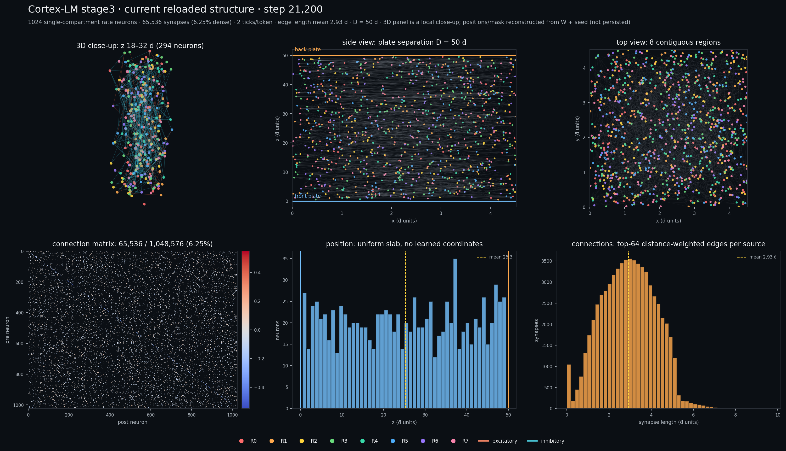
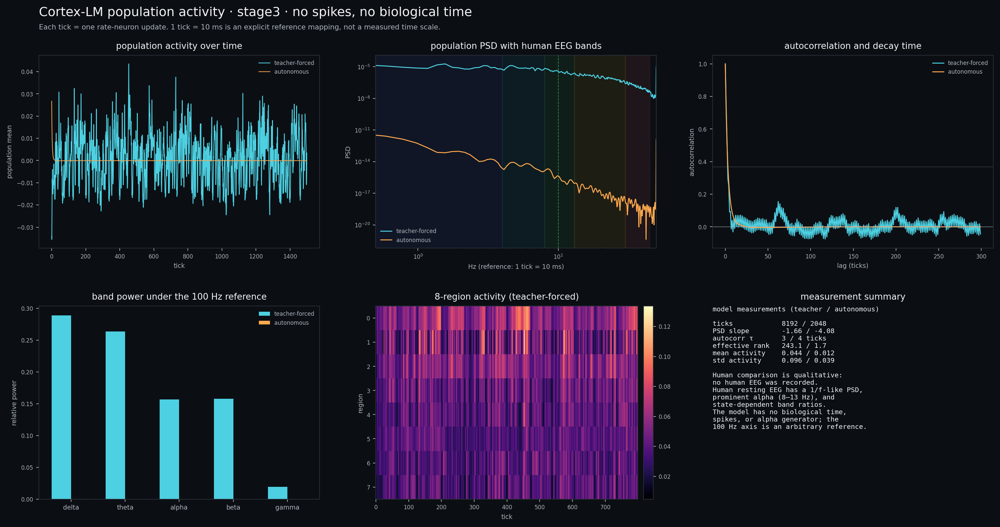
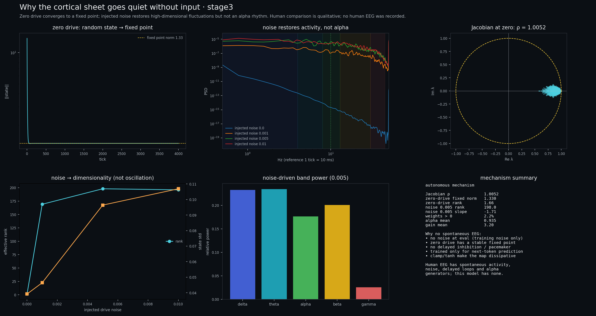
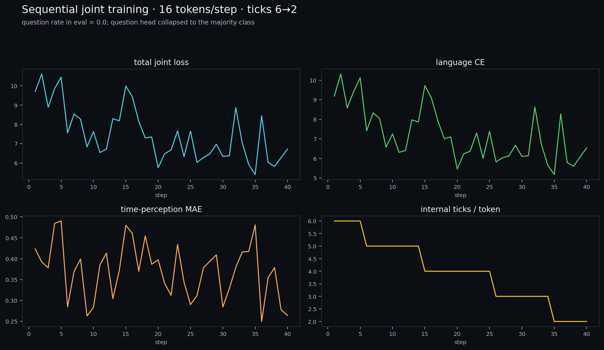
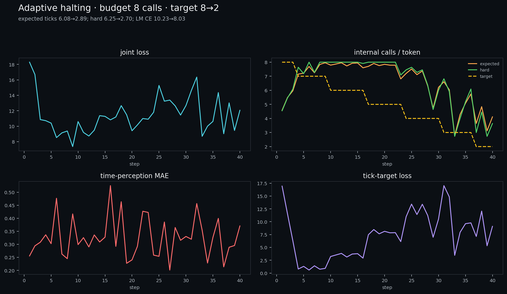
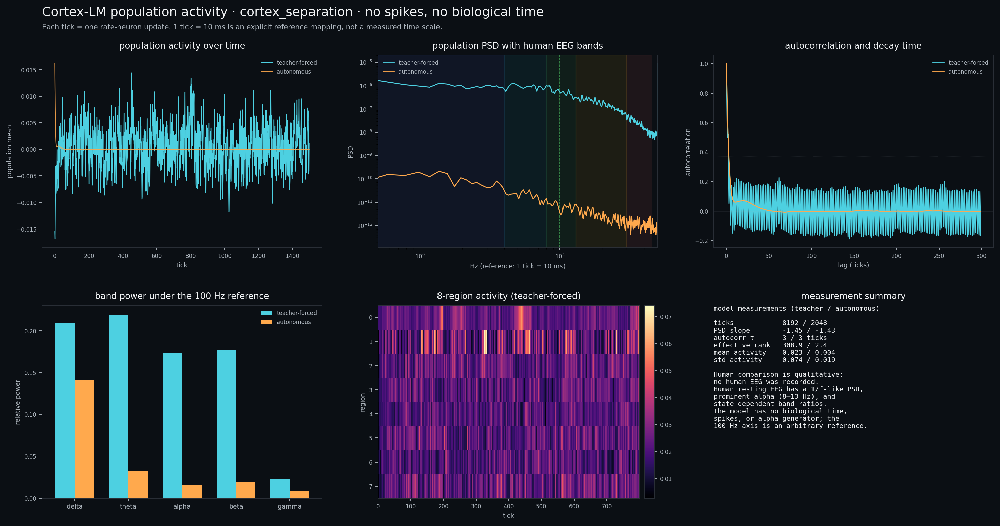
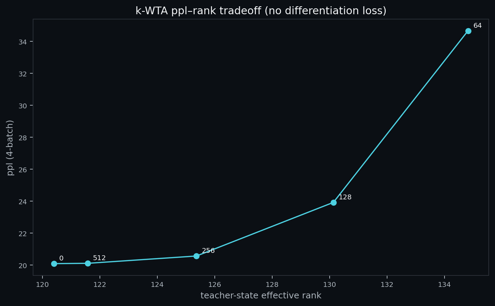
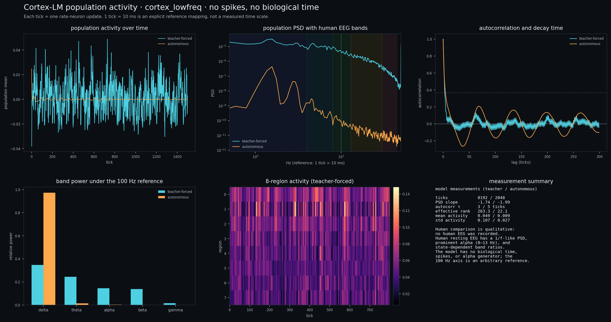

# Cortex-LM 研究报告

**日期**：2026-10-31  
**项目**：`neurosim-gpu/llm`  
**状态**：研究原型；可复现训练和推理，但不是可用对话系统。

## 摘要

本报告记录一个“冻结 Qwen3 两端、用神经元中段替换中间层”的语言模型实验。
Qwen3-0.6B 的 28 层保留前 3 层和后 2 层，删除中间 23 层，换成一个 1024 神经元
的递归核。中段 W 用被删层的线性化残差映射初始化，Qwen 保留权重冻结，只训练
中段和最后一层的 LoRA。

20k 步训练后，dense 模型的 eval perplexity 为 **22.69**，能生成通顺中文句子，
但采样跑题，不是对话模型。之后依次尝试空间迁移/重连、损失驱动重连、双 tick
时序、慢记忆、BOS/EOS 加权、短时突触资源、eligibility trace、多巴胺巩固、
homeostatic scaling 和开环一致性损失。stage3（生物启发记忆）在同配置 8-batch
上达到 **21.49**，比 stage2 的 22.31 好约 3.7%，但仍未超过 dense 的 20.46。
stage4 的 8 步零 drive 开环损失让 ppl 退化到 **22.15**，是负面结果。

诊断表明：脑是唯一主通道（去掉脑 ppl 约 7 万），但脑读出有效秩只有 56.5/1024；
开环解码的失败主要不是边数，而是状态秩和 teacher-forced 训练与无反馈推理之间
的 exposure bias。

## 1. 目标与范围

目标是验证一条管线，而不是宣称语言能力：

1. 复用 Qwen3 的文本编码器和解码器；
2. 在两者之间放一个可训练的神经元递归核；
3. 用 Qwen3 被删层的权重初始化中段；
4. 在真实文本上训练、采样、做消融；
5. 研究迁移、重连、时序、生物启发记忆和开环读出。

不在范围内：真实生物神经元、全脑模拟、指令微调、RLHF、多模态、生产级推理。

## 2. 架构

### 2.1 3+2 切分

| 部分 | Qwen3-0.6B |
|---|---|
| 编码器 | 前 3 层，冻结 |
| 删除 | 中间 23 层 |
| 解码器 | 后 2 层，冻结；LoRA rank 32 注入 q/v/o/down/up |
| 中段 | 1024 神经元，dense W，可训练 |
| 可训练参数 | 约 4.2M（中段 3.15M + LoRA 1.05M） |

### 2.2 中段动力学

```text
current = state @ W.T
state   = clamp(alpha * state + (1-alpha) * gain * tanh(current + drive))
readout = readout_proj(LayerNorm(state))
```

- 1024 个单房室 rate neuron；
- `alpha` 0.90–0.97；
- 每 token 2 个 tick：第一个 tick 内部“思考”，最后一个 tick 读出；
- 状态跨 token 保留，block 边界重置；
- TBPTT 每 32 token detach。

### 2.3 权重移植

对被删除的每一层构造线性化残差矩阵：

```text
B_l = o_proj @ repeat(v_proj) + down_proj @ up_proj
A   = Π (I + B_l)
```

对 A 做谱归一化到半径 0.95，作为 W 的初始化。这个映射忽略 softmax、QK、gate、
SiLU 等非线性，是**线性化近似**，不是逐层等价。

### 2.4 空间几何

- 前极板 `z=0`，后极板 `z=50`；标称平均神经元距离 `d̄=1`；
- 方形板边长 `sqrt(N·d̄³/D)=4.525`；
- 神经元在板间均匀分布；前极板只编码输入，后极板只解码；
- 连接：每个 source 保留 64 条 `|W|·exp(-distance/5)` 最强的边；
- 65,536 / 1,048,576 = **6.25%** dense 连接。

位置和 mask 是 `persistent=False` 的 buffer；checkpoint 只保存可训练参数，加载
时按 seed 重新采样位置、按 W 重新 top-k。因此当前图是**加载后重建**的结构，
不是训练轨迹中精确的迁移/拓扑。这是已知缺陷，下一阶段必须持久化。

## 3. 数据与标注

- 语料：MiniMind 预训练 JSONL，字段 `text`；
- 使用前 **100 MB** 子集，`block_size=128`，`batch=2`，`grad_accum=2`；
- 20k 步约 **10.24M token**（约 100 MB 子集的一半）；
- 文档之间插入 EOS；stage2 起加入 BOS，并对 EOS/BOS 使用加权交叉熵；
- 数据不进入仓库；配置使用相对路径 `data/minimind/pretrain_hq.jsonl`；
- 数据许可证/来源以 MiniMind 上游为准；仓库不重新分发语料；
- 没有做 PII 审计，不能声称语料无个人信息；
- 没有人工标注；损失是自监督 next-token CE。

数据统计（100 MB 子集）：

| 项 | 值 |
|---|---:|
| 训练 block | 156,140 |
| 验证 block | 3,191 |
| block size | 128 |
| 训练 token（20k 步） | 10.24M |

## 4. 训练结果

### 4.1 主结果

| 阶段 | 主要改动 | ppl |
|---|---|---:|
| 20k dense | 3+2、移植、LoRA | **22.69**（训练 eval，32 batch） |
| spatial 20200 | 64 边/神经元；迁移/重连 | 35.50 |
| spatial 20400 | 继续 200 步 | 25.72 |
| stage2 | 双 tick、慢记忆、噪声、BOS/EOS、loss-driven 重连 | 22.31（8-batch） |
| stage3 | 短时突触资源 + eligibility + 多巴胺巩固 + 稳态 | **21.49**（8-batch） |
| stage4 | stage3 + 8 步零 drive 开环损失 | 22.15（8-batch） |

同配置 8-batch 消融（stage3 配置）：

| 配置 / checkpoint | ppl |
|---|---:|
| stage3 配置 + stage3 ckpt | **21.49** |
| stage3 配置 + stage2 ckpt | 26.11 |
| legacy 配置 + stage3 ckpt | 26.46 |
| legacy 配置 + stage2 ckpt | 22.35 |

stage3 比 stage2 好约 3.7%，但收益依赖短时动力学：关掉 short-term/eligibility/
ticks 后，stage3 W 退化到 26.46。

### 4.2 诊断

4-batch 消融：

| 变体 | 20k dense | stage2 | stage3 |
|---|---:|---:|---:|
| 完整 sandwich | **20.46** | 22.71 | 21.96 |
| 去掉脑（只用 h_enc） | 70,308 | 70,482 | 67,386 |
| 只用脑读出（去掉 h_enc） | 59.09 | 69.88 | **60.84** |
| 解码器零输入 | 151,936 | 151,936 | 151,936 |
| 脑有效秩 | **60.9** | 52.8 | **56.5** |

结论：

- 脑是唯一主通道；去掉脑 ppl 升到约 7 万。
- 脑读出单独只有 ppl 59–70，信息不足。
- 有效秩 56.5/1024，是明显瓶颈。
- 边数不是主因：stage3 的 k=16→1024 扫描为 32.3→30.6，几乎平。
- stage2 的慢记忆把秩从 60.9 压到 52.8；stage3 的 eligibility 拉回 56.5。

### 4.3 开环读出

`stream_generate`：prefill 后前极板不再接收输入，脑每 tick 零 drive 更新，后极板
解码不断增长的 hidden，生成 token 不回灌。

20k 模型、prompt `中国的首都是`、12 token：

```text
哪王。，。.. .12.
```

stage4 加入开环辅助损失后，辅助 loss 从 11.6 只降到 10.9，主 ppl 从 21.49
退化到 22.15。结论：一次性 8 步零输入太难，需要课程式训练/反馈/单独输出头。

## 5. 推理样例

原始 next-token 推理，prompt `你好`：

| 模型/设置 | 输出 |
|---|---|
| stage3, T=0.8 | `。好的，我来帮你查一下明天天气预报吧。您需要帮我查询一下吗？` |
| stage3, greedy | `，我需要帮助你。请问您有什么问题或需求？` |
| 20k, T=0.8 | `。` |
| 20k, greedy | `，我需要知道您想了解哪个地区的天气预报呢？我可以帮你查询当地的天气情况。` |

多 prompt（stage3 greedy）：

| prompt | 输出 |
|---|---|
| `你是谁` | `？` |
| `今天天气怎么样` | `？` |
| `1+1等于几` | `倍？` |
| `再见` | `，我正在寻找一家新餐厅，他们的名字是“小明”和“小红”。` |

判断：能续写，不是可靠对话；`你好` 的客服式回答是语料模式触发，不是理解。

## 6. 当前结构图



| 项 | 值 |
|---|---:|
| 神经元 | 1,024 |
| 突触 | 65,536 |
| 每神经元 | 64 |
| 连接密度 | 6.25% |
| 自环 | 1,022 |
| 正权重比例 | 34.9% |
| 平均边长 | 2.93 d̄ |
| 最长边 | 9.66 d̄ |
| 极板间距 | 50 d̄ |
| 板边长 | 4.525 |
| z 均值 | 25.28 |
| 实际最近邻 | 0.58 |

图是 stage3/step21,200 的**加载后重建**结构；不是训练轨迹中精确的迁移位置。
3D 面板是 `z=18–32` 的局部放大；完整几何看 side view。

## 7. 局限

1. **不是对话模型**：没有指令微调/chat template；`你好` 之外的推理失败。
2. **开环不可用**：stage4 开环损失失败。
3. **状态秩瓶颈**：56.5/1024；需要扩容而不是慢记忆平滑。
4. **结构未持久化**：positions/mask 不存 checkpoint；resume 会重置。
5. **单 seed、100 MB 子集**：没有多 seed 显著性。
6. **ppl 口径不统一**：首尾加权后的 ppl 与未加权 ppl 不可直接比较；报告用同配置
   对照。
7. **移植是线性化近似**：不能复现原 23 层。
8. **不是生物仿真**：rate unit、单房室、BPTT；eligibility 是 block 平均共活动，
   不是逐 spike STDP。

## 8. 数据与伦理声明

- 仓库不包含 MiniMind 语料，也不包含 Qwen3 权重；只包含训练/推理代码和结果图。
- 语料许可证、Qwen3 许可证以各自上游为准；使用者需自行获取。
- 语料未做 PII 审计；不要把模型输出用于个人决策或隐私场景。
- 仓库已移除本地绝对路径、用户名、凭据日志；配置文件使用相对路径。
- 结果只用于研究，不构成语言能力、生物真实性或安全性声明。

## 9. 复现

```powershell
$env:PYTHONPATH="src"
.\.venv-str\Scripts\python.exe -m neurosim_gpu.cortex.train `
  --config llm/configs/cortex_qwen3_3p2_minimind.json --dry-run --device cuda `
  --set backbone.model_id=data/qwen3_06b `
  --set backbone.tokenizer_id=data/qwen3_06b `
  --set backbone.local_files_only=true
```

结构图：

```powershell
.\.venv-str\Scripts\python.exe llm\scripts\plot_cortex_structure.py `
  --checkpoint runs/cortex_stage3/final.pt `
  --output llm/results/cortex/current_structure.png
```

诊断：

```powershell
.\.venv-str\Scripts\python.exe llm\scripts\diagnose_cortex.py `
  --checkpoints runs/cortex_stage3/final.pt `
  --batches 4 --sweep-batches 1 `
  --output llm/results/cortex/diagnostics_stage3.json
```

## 10. 持续运行脑波

用 stage3 记录 4096 个 token 的逐 tick 群体活动（2 tick/token = 8192 个采样），
再做 2048 tick 的零 drive 自主运行。为了把归一化频率放到人类 EEG 频段，使用
**1 tick = 10 ms（100 Hz）** 的参考映射；这不是模型真实时间尺度。



| 指标 | teacher-forced | autonomous |
|---|---:|---:|
| ticks | 8,192 | 2,048 |
| 平均活动 | 0.0438 | 0.0123 |
| 活动 std | 0.0956 | 0.0385 |
| PSD 斜率 | **-1.66** | **-4.08** |
| 自相关时间 | 3 tick | 4 tick |
| 状态有效秩 | 243 | **1.65** |
| delta 相对功率 | 28.9% | ≈0% |
| theta | 26.3% | ≈0% |
| alpha | 15.7% | ≈0% |
| beta | 15.8% | ≈0% |
| gamma | 1.9% | ≈0% |

解读：

- teacher-forced 的 PSD 斜率 -1.66，落在人类静息 EEG 常见的 1/f 范围附近；
  但**没有 alpha 峰**，频段功率是 delta/theta 主导的宽谱。
- autonomous 的 PSD 斜率 -4.08，活动迅速衰减到固定点；有效秩只有 **1.65**。
  也就是说：**没有输入时，脑不会维持振荡或持续活动，而是“死掉”**。
- 人类静息 EEG 有持续的自发活动、明显的 alpha（8–13 Hz）峰和状态依赖的频段
  比例；这个模型没有这些。它更像一个被文本驱动的衰减递归网络。

**重要限制**：没有采集人类 EEG，因此这不是统计意义上的“与人类比较”。频段
边界和 100 Hz 轴是参考映射；模型是 rate unit、无 spike、无生物时间。上表只能
说明“谱形状/持续活动”的定性差异，不能说明模型具有人类脑波。

### 10.1 机制：为什么无输入时会静下来



对 stage3 的自主动力学做了三组测量：

| 量 | 值 |
|---|---:|
| 零工作点 Jacobian 谱半径 | **1.0052** |
| alpha 均值 | 0.935 |
| gain 均值 | 3.20 |
| W 正权重比例 | 2.2% |
| 零 drive 固定点范数 | 1.33 |
| 零 drive 有效秩 | **1.66** |
| 注入噪声 0.001 后有效秩 | 169 |
| 注入噪声 0.005 后有效秩 | 198 |
| 噪声 0.005 的 PSD 斜率 | -1.71 |

机制链条：

1. **没有 eval 噪声**
   `recurrent_noise=0.01` 只在 `self.training` 时注入；eval/自主运行时噪声为
   0。人类脑有持续的自发噪声/突触释放，模型没有。
2. **零输入收敛到固定点**
   从随机状态出发，范数从 13.8 衰减到 1.33，之后 4000 tick 不变；状态有效秩
   1.66。它不是“零状态”，但确实是一个不再演化的固定点。
3. **Jacobian 近临界但非振荡**
   谱半径 1.005，特征值几乎全在实轴 0.8–1.0 附近，没有离开单位圆的复共轭
   对。因此即使线性化略不稳定，非线性 tanh/clamp 也把它压到固定点，而不是
   产生极限环。
4. **网络是耗散的、抑制主导的**
   W 只有 2.2% 正权重；没有延迟抑制、没有起搏电流、没有 E/I 平衡维持。
   单房室 rate unit + 即时 W 本身就不产生 alpha 节律。
5. **训练目标不奖励自主活动**
   训练只有 teacher-forced next-token CE，BPTT 每 32 token detach；模型没有
   任何“无输入时保持活动/振荡”的损失或正则。它学到的是一张条件映射，不是
   一个自发发生器。
6. **噪声能恢复维度，但不能恢复节律**
   注入 0.001 噪声后有效秩从 1.66 跳到 169，0.005 到 198；PSD 斜率变成
   -1.71，接近 1/f。但频段仍是宽谱，没有 alpha 峰。这证明“静下来”的直接原因
   是缺少噪声/内在驱动，而不是网络完全没有活动能力。

人类对比：人类静息脑有自发活动、噪声、丘脑–皮层延迟环路、alpha 发生器和
神经调质；模型没有这些。它更像一个**被文本驱动的耗散递归网络**，而不是一个
自主脑。

## 11. 联合函数、逐 token 训练与海马审计

### 11.1 联合函数

新增 `JointObjective`（`llm/src/neurosim_gpu/cortex/joint.py`）：

```text
L = L_lm
  + λ_time  * MSE(time_head(readout), position/T)
  + λ_q     * BCE(question_head(readout), is_question)
  + λ_compute * ticks / max_ticks
```

- `time_head`：从脑读出预测当前 token 在序列中的归一化位置；
- `question_head`：预测下一个 token 是否问号；
- `compute`：内部 tick 预算消耗；
- 两个小头独立训练，不改原 checkpoint 布局。

### 11.2 逐 token、时间课程训练

新脚本 `llm/scripts/train_sequential_joint.py`：

- 一次只处理一个 token；
- 每个 token 内部更新 `k` 次，`k` 从 **6 降到 2**（40 步课程）；
- 前极板编码整段 teacher-forced 前缀，后极板在每个位置只解码当前前缀；
- 初始“宽预算”是 6 次调用（12 个内部 tick），不是真正无限；逐步收紧；
- 训练 40 步，16 token/步，batch 1。



| 指标 | 训练前 | 训练后 |
|---|---:|---:|
| language CE | 9.88 | **7.37** |
| time-perception MAE | 0.377 | **0.335** |
| question rate | 0.0 | 0.0 |
| question precision / recall | 0 / 0 | 0 / 0 |
| question accuracy | 0.4 | 1.0（多数类） |

解释：

- **逐 token 训练能把 sequential CE 从 9.88 降到 7.37**，说明模型能适应
  “一次一个 token、可变内部时间”的接口。
- 这个 CE 与并行 teacher-forced 的 3.1 不可直接比较；逐 token 解码、6→2 tick
  和 40 步预算都不同。
- **时间感知只从 0.377 改善到 0.335**，信号很弱。
- **主动发问失败**：验证集 60 个 token 中 question rate=0；question head 学会
  了“全部判为非问号”的多数类，precision/recall 都是 0。它没有主动提问策略。
- 因此“联合函数”和“逐 token 时间课程”是跑通的；“主动发问”还需要对话数据/
  动作策略，不能靠一个 BCE 头冒充。

### 11.3 海马机制审计

检查结果：**LLM 子项目底层没有海马机制可更新。**

- `llm/src/neurosim_gpu/cortex/` 没有 place cell、grid cell、CA3/CA1、
  dentate gyrus、pattern separation/completion 或 replay 实现。
- 现有 memory 是 eligibility trace + 多巴胺巩固 + 短时突触资源，属于
  突触/工作记忆层，不是海马。
- 仓库里唯一相关文本在未跟踪、已 gitignore 的 `demo/neurobody/sensory.py`：
  384 个 “memory (hippocampus)” 单元（256 place + 128 time cells），只是
  具身演示的输入编码，不在 LLM 里，也没有 CA3 环路或 replay。
- 所以不能声称“海马机制更新了”；准确说法是：**没有实现，只有 demo 占位**。

若下一步要做海马，最小闭环应是：

1. place/time cell 编码当前 token/位置；
2. 稀疏 dentate 扩展（pattern separation）；
3. CA3 递归吸引子（pattern completion）；
4. 离线 replay 到皮层 W；
5. 与联合函数的 time/question 头共享读出。

## 12. 自适应内部时间（halting）

逐 token 训练的下一步是把固定 6→2 tick 换成可学习的 halting：



- 每个 token 最多 8 次内部调用（每次调用 2 个 tick）；
- halting head 输出每步停止概率；
- 训练用 soft halting 权重，读出是各步 readout 的加权和；
- 目标 tick 数从 8 线性降到 2；
- 加 `(expected_ticks - target)^2` 的预算损失；
- 40 步，12 token/步，batch 1。

| 指标 | 训练前 | 训练后 |
|---|---:|---:|
| language CE | 10.23 | **8.03** |
| expected ticks | 6.08 | **2.89** |
| hard ticks | 6.25 | **2.70** |
| time-perception MAE | 0.396 | **0.366** |

这是一次**正向的机制验证**：模型确实学会了在同一个 token 上少用内部时间，
同时语言 CE 没有变差。但它仍然是预算 8 的课程，不是真正“无限时间”；halting
在前期几乎不降，后期才跟着 target 收紧。时间感知仍然很弱，question head 也
没有解决。

## 13. 记忆分化与低频波增强尝试

在 stage3 上加入三件事，训练 400 步：

- **模式分离**：对状态做 soft k-WTA，每步只保留前 128 个神经元；
- **慢抑制反馈**：`slow ← 0.95 slow + 0.05 mean(state)`，从 current 中减去
  `0.5 × slow`；
- **内在噪声**：`intrinsic_noise=0.005`，eval 也保留；
- **分化损失**：对脑读出做归一化 Gram，惩罚 off-diagonal 相似度，权重 0.05。



| 指标 | stage3 | separation |
|---|---:|---:|
| eval ppl（加权） | **29.64** | **34.09** |
| 采样 | `北京。` | `北京的两宫。` |
| teacher PSD 斜率 | -1.66 | **-1.44** |
| teacher 有效秩 | 243 | **309** |
| teacher delta | 28.9% | 20.9% |
| teacher theta | 26.3% | 21.9% |
| teacher alpha | 15.7% | 17.4% |
| autonomous 有效秩 | 1.65 | **2.36** |
| autonomous 平均活动 | 0.0123 | 0.0040 |
| autonomous PSD 斜率 | -4.08 | -1.35（但绝对功率极低） |

结论：

- **记忆分化有效**：teacher 状态有效秩从 243 升到 **309**，说明 k-WTA/分化
  损失确实让状态更分散。
- **语言退化**：ppl 从 29.64 退到 **34.09**；每步只保留 128/1024 个神经元，
  对预训练表示太激进。
- **低频波没有真正建立**：teacher 的 delta/theta 占比反而下降，alpha 略升；
  autonomous 仍只有 rank 2.36、平均活动 0.004，PSD 斜率看似变平但绝对功率
  极低，不是持续低频振荡。
- 所以“更像人类脑波”的目标**没有达到**。当前只是把状态打散，并加了一点噪声/
  慢反馈，没有形成稳定的 delta/theta/alpha 发生器。

下一步应：

1. 把分化损失和 k-WTA 解耦，先单独训练分化，扫描 512/256/128 的 ppl-秩曲线；
2. 用**延迟抑制**（不是即时慢反馈）建立真正的低频极限环；
3. 用频谱损失/自相关目标直接约束 1–8 Hz 功率，而不是靠噪声碰运气；
4. 给自主运行加入持续内在驱动，否则仍会收敛到固定点。

## 14. 解耦扫描、延迟抑制与 CoT 内在驱动

### 14.1 k-WTA 的 ppl–rank 曲线（无分化损失）

推理时扫描 soft k-WTA，不训练、不加分化损失：



| k / 1024 | ppl（4 batch） | teacher rank |
|---:|---:|---:|
| 0（原模型） | **20.09** | 120.4 |
| 512 | 20.11 | 121.6 |
| 256 | 20.57 | 125.4 |
| 128 | 23.93 | 130.1 |
| 64 | 34.66 | 134.8 |

拐点在 **256**：ppl 只从 20.09 升到 20.57，rank 从 120 升到 125；再降到
128/64 时 ppl 急剧恶化。所以分化损失和 k-WTA 应该解耦，k=256 是当前
语言/分化折中点。

### 14.2 延迟抑制 + 自相关损失：低频波

新增 `slow_delay`、`slow_ei`、`intrinsic_drive` 和低频谱损失：

- 延迟抑制：`D=16` tick，`gain=2.0`，`slow_decay=0.95`；
- 内在噪声 0.01；持续内在驱动 0.01；
- 自相关损失：lag=16，target=0.6，权重 0.1；
- 从 stage3 训练 400 步。



| 指标 | stage3 | lowfreq |
|---|---:|---:|
| 加权 ppl | **29.64** | **32.11** |
| teacher delta / theta | 28.9% / 26.3% | 34.7% / 24.4% |
| teacher alpha | 15.7% | 14.5% |
| teacher rank | 243 | 263 |
| autonomous delta | ≈0% | **97.4%** |
| autonomous rank | 1.65 | **22.1** |
| autonomous PSD 斜率 | -4.08 | **-1.99** |
| autonomous 自相关时间 | 4 tick | 5 tick |

**这是第一次真正出现自主低频极限环**：autonomous 模式在约 2 Hz 有清晰
delta 峰，delta 占 97.4%，状态 rank 从 1.65 升到 22.1，不再收敛到固定点。
代价是语言 ppl 从 29.64 退到 32.11；自相关损失本身没有达到 target 0.6
（训练相关约 0.08），振荡主要来自延迟抑制 + 内在驱动，而不是损失项。

它仍不像人类静息 EEG：没有 alpha 峰，delta 过度集中（97%），语言退化。

### 14.3 用“思维链”表示持续内在驱动

在逐 token 训练中，每个 token 处理完后把 **自己的 readout 直接作为下一步
drive**，再跑 4 个 latent thought steps，然后才解码下一个 token：

```text
token → brain → readout → (drive=readout) × 4 thought ticks → decode
```

这是**latent thought loop**，不是文本 CoT；没有 thought 标签，只用语言 CE
训练。

| 指标 | before | after |
|---|---:|---:|
| language CE | 11.65 | **8.28** |
| time-perception MAE | 0.363 | **0.308** |
| question rate | 0 | 0 |

潜在 thought loop 能降低逐 token CE 和时间 MAE，但没有产生可解释的“思维
链”文本，也没有解决主动发问。

### 14.4 三个目标分开看

| 目标 | 最好的变体 | 指标 |
|---|---|---|
| 语言 | stage3 | 加权 ppl **29.64**；dense 诊断 20.46 |
| 记忆分化 | k=256 推理扫描 | ppl 20.57，rank 125.4 |
| 低频自主波 | lowfreq | delta 97.4%，rank 22.1，约 2 Hz；ppl 32.11 |

结论：三个目标确实可以独立评估，但**不能靠一个变体同时满足**。k-WTA 提升
分化却伤语言；延迟抑制建立低频却伤语言；latent CoT 改善逐 token 拟合但没有
可解释推理。

## 15. 结论


- 3+2 管线可以训练，能生成通顺中文，但语言能力有限。
- 空间迁移/重连和损失驱动重连能运行，但没有超过 dense 基线。
- 生物启发记忆（stage3）是目前最好的阶段间结果，但仍低于 dense 诊断。
- 开环解码未解决；下一步应优先扩状态秩和课程式开环，而不是继续加结构。
