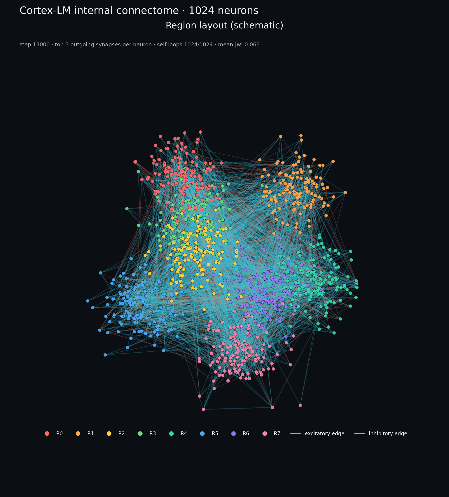
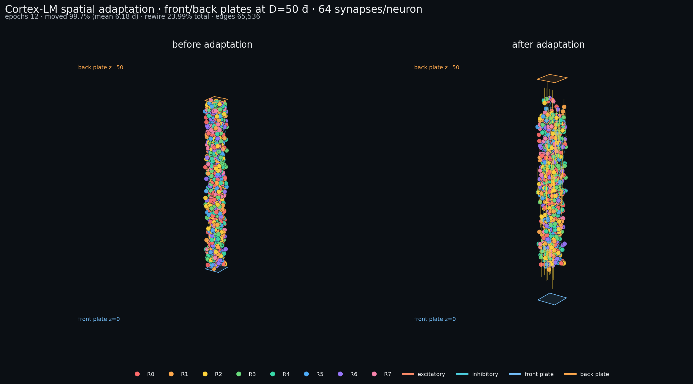

# Cortex-LM：Qwen3 3+2 × 神经元中段

> **状态（2026-10-31）：3+2、移植、20k 长训练、开环读出、空间/损失驱动重连、
> 时序记忆、生物启发记忆和开环一致性训练已完成。** 20k dense eval ppl
> **22.69**；stage3 生物启发记忆同配置 8-batch ppl **21.49**，是当前最好的
> 生物阶段结果，但仍未超过 dense 的 20.46。stage4 一次性加 8 步零 drive 开环
> 损失，ppl 反而退化到 **22.15**，辅助 loss 11.6→10.9 几乎不降。结论：开环
> 需要课程式训练/反馈，不能直接加长零输入 rollout；长期记忆和开环解码仍未
> 解决。

## 1. 架构

Qwen3-0.6B 有 28 层。保留下来的只有两端：

```text
token ids
  │
  ▼
[ embedding + 前 3 层 ]                  ← Qwen3，冻结
  │ h_enc [B, T, 1024]
  ▼
[ 1024 个神经元，稠密递归 W (1024×1024) ] ← 中段，训练
  │ h_brain [B, T, 1024]
  ▼
[ h_enc + gate · h_brain ]                ← gate 初始 1.0
  │
  ▼
[ 后 2 层 + final norm + lm_head ]        ← Qwen3，冻结
  │
  ▼
next-token logits
```

中间 23 层（第 3–25 层）从模型树里删除，不再参与前向、反向、优化器或
checkpoint。这样 8 GiB 卡上保留的 Qwen3 只有约 2.34 亿参数（0.94 GB fp32），
中段是一个 1024×1024 的可训练递归矩阵。

- 保留的 Qwen3 权重全部冻结；**没有 LoRA**，可训练参数只有中段。
- 1024 = Qwen3 的 hidden size，一个神经元对应一个残差通道；输入/读出投影
  用单位阵初始化，因此中段和残差流维度直接对齐。
- `ticks_per_token=1`：一个 token 推进一次递归；状态跨 token 保留，每 32 个
  token 截断 BPTT。

## 2. 权重移植：线性化残差

“直接等效替换”在实现里定义为**被删除 23 层的线性化残差映射**，而不是把
Transformer 原样塞进一个矩阵。

对每个被删除的 block `l`：

```text
B_l = o_proj_l @ repeat(v_proj_l) + down_proj_l @ up_proj_l
```

- `o @ v` 是 attention 的 value/output 路径；GQA 的 v 头先按 q 头数复制。
- `down @ up` 是 MLP 的两层线性复合；`q/k`、softmax、`gate_proj`/SiLU 和
  残差里的逐点非线性被丢掉。
- 按残差链组合：`A = (I + B_25) … (I + B_3)`。
- 用幂迭代估计谱半径，把 `A` 缩放到 `target_radius=0.95`，作为 `W` 的初值。

这是一个**功能性初始化**：它给中段一个来自 Qwen3 的非随机起点，但不是严格
等价的 Transformer。attention 的 token 混合、softmax 和 MLP 门控没有进入
这个线性映射；这些只能靠递归状态和训练去补。

代码：[`transplant.py`](../src/neurosim_gpu/cortex/transplant.py)。测试覆盖
GQA 形状、组合和谱半径（[`test_cortex_transplant.py`](../../tests/test_cortex_transplant.py)）。

## 3. 中段动力学

每个 token：

```text
drive_t = LayerNorm(h_enc_t) → Linear(1024, 1024)   # 单位阵初始化
current = W @ state
state   = clamp(alpha·state + (1-alpha)·gain·tanh(current + drive_t))
readout = Linear(1024, 1024)(LayerNorm(state))      # 单位阵初始化
h_brain = readout
```

- `W` 是 `nn.Parameter`，1024×1024，**可训练**；这是与旧版“冻结稀疏边”的
  关键区别。
- `alpha ∈ [0.90, 0.97]`、逐神经元/逐区域 `gain`、初始状态和 gate 都可训练。
- 读出和输入投影都从单位阵开始；LayerNorm 保留，用来稳定尺度和梯度。
- 状态在 `[0, 1]`，读出经过 LayerNorm 后再进残差流；门控初始 1.0。

### 3.4 3D 连接图



- 节点：1024 个神经元，按 8 个 region 着色。
- 边：每个神经元只画最强的 3 条出边（3072/1,048,576），橙色为兴奋、青色为抑制；全矩阵 100% 稠密，画全部边不可读。
- 位置：**示意布局**，8 个 region 中心放在球面上、神经元在组内散布；模型本身没有学习 3D 坐标，所以这不是“学出来的脑图”。
- 自环：W 的对角线 1024/1024 非零，图中没有画自环，只统计在标题里。
- 另一张图用 W 的 Fiedler 谱嵌入定位：`llm/results/cortex/connectome_3d_spectral.png`；汇总图是 `llm/results/cortex/connectome_3d.png`，包含 8×8 region 平均权重和权重分布。

生成命令：

```powershell
.\.venv-str\Scripts\python.exe llm\scripts\plot_cortex_connectome.py `
  --checkpoint runs/cortex_long_lora/last.pt `
  --mode region --edges-per-source 3 `
  --output llm/results/cortex/connectome_3d_region.png
```

统计写在同名 `.json`。这是**固定 dense W 的可视化**，不表示存在结构重连或迁移。

### 3.5 双极板与迁移/重连实验

按“前极板只编码外部输入、不接收神经元回传；后极板只解码；输出不回灌”
的约定，搭建了第一版空间几何：
- 前极板 `z=0`，后极板 `z=50`；标称神经元平均距离 `d̄=1`。
- 方形板边长 `sqrt(N·d̄³/D)=4.525`，板间体积约 1024 立方单位。
- 神经元初始均匀分布在板间；前极板只产生输入，后极板只读状态。



离线适应实验（不训练 LLM，权重和优化器不动）：

| 项 | 值 |
|---|---:|
| 神经元 | 1024 |
| 稀疏连接 | 64 条/神经元，65,536 条（dense 的 6.25%） |
| 适应 epoch | 12 |
| 迁移 | 99.7% 神经元累计移动 >0.05 d̄；平均累计位移 6.18 d̄ |
| 重连 | 每 epoch 形成/修剪各 655 条（各 1%），累计 7,860/7,860 |
| 累计重连比例 | **23.99%** 的边被触及 |
| 边数 | 保持 65,536 |

实现：[spatial.py](../src/neurosim_gpu/cortex/spatial.py) 和
[脚本](../scripts/cortex_spatial_adaptation.py)。迁移使用了
`migrate_neurons`；候选边打分使用 `score_candidate_edges`。§7.4 已把同样的
原语接回 200 步训练；§7.3 实现了开环读出。当前结果都是负面/中性，不代表
语言能力提升。

### 3.6 当前神经元结构图（stage3）


- **结构**：1024 个单房室 rate neuron；每 token 2 个 tick，最后 tick 读出
  “说出来”的 token；8 个连续 region。
- **位置**：在 `z=0` 前极板和 `z=50` 后极板之间均匀分布；板边长 4.525，
  体积 1024；标称 d̄=1，实际最近邻平均 **0.58**。
- **连接**：65,536 条（64/神经元，dense 的 6.25%）；自环 1,022 条；正权重
  34.9%；平均边长 **2.93 d̄**，最长 9.66 d̄。
- 右下矩阵和直方图来自训练后 W；3D 面板是 `z=18–32` 的局部放大，完整
  z 范围看 side view。

**注意**：`positions` 和 `edge_mask` 仍是 `persistent=False`，checkpoint 不
保存它们；这张图是**加载后按 W+seed 重建**的当前状态，不是训练轨迹中精确的
位置/拓扑。图中位置不是学习到的坐标；连接也不是严格 Dale 定律的稀疏图。

## 4. 张量契约
| 张量 | 形状 | 生命周期 |
|---|---|---|
| `input_ids` | `[B, T]` int64 | 一个 block |
| `labels` | `[B, T]` int64，`-100` 忽略 | 对齐 |
| `h_enc` | `[B, T, 1024]` | 前 3 层 |
| `state` | `[B, 1024]` | 跨 token；block 边界重置 |
| `h_brain` | `[B, T, 1024]` | 每 token 读出 |
| `logits` | `[B, T, 151936]` | 后 2 层 + head |

## 5. 训练数据

使用 MiniMind 预训练语料（本地路径按配置；仓库不包含数据）：

```text
data/minimind/pretrain_hq.jsonl
```

- JSONL，每行 `{"text": ...}`；`data.text_field="text"`。
- 配置里 `data.max_bytes=104857600`（100 MB），只读前 100 MB，不把 1.6 GB
  文件整体载入内存。
- `max_documents` 可进一步限制行数；`data.extensions=[".jsonl"]`。
- 文档之间插入 Qwen3 的 `eos`，token 流按 `block_size+1` 切成定长 block；
  缓存键包含文件大小/mtime、`text_field`、`max_bytes`、block size 等。
- 本次短程运行用 `--set data.max_bytes=10000000`（10 MB，约 200 万 token）
  和 `--set data.block_size=128`。

数据代码：[`data.py`](../src/neurosim_gpu/cortex/data.py)。`read_documents`
现在支持 JSONL 流式读取和字节/文档上限。

## 6. 参数、显存、dry-run

Qwen3-0.6B 3+2 的真实权重 dry-run（batch 2 × 32 token，bf16 autocast，
gradient checkpointing 开）：

| 项 | 值 |
|---|---|
| 保留的 Qwen3 参数 | 234,238,208（3 + 2 层 + embedding/norm/head） |
| 中段可训练 | **3,153,930**（W 1,048,576；输入/读出 2,097,152；gain/norm 等约 8k） |
| 总参数 | 237,392,138 |
| 峰值显存 | 1,437 MB（短序列） |
| 脑 | 1024 神经元，W 1,048,576 条稠密连接，谱半径 0.95，1 tick/token |
| 梯度 | 14/14 个可训练张量有梯度，范数约 90.3（训练时 clip=1.0） |
| 活动 | mean state 0.064；饱和比例 0（随机 token 输入） |
| loss | 17.77，输入均匀随机 token；**不是语言 loss** |

短序列 dry-run 的耗时受首次 CUDA kernel 初始化影响，不作为吞吐。实际训练
在 `block=128, batch=2, grad_accum=2` 下，稳定后约 **600–700 token/s**（RTX
5070 Laptop、8 GiB、FP32 基座 + bf16 autocast）。

## 7. 已启动的短程训练

2026-10-31 在 10 MB MiniMind 子集上从 20 步 checkpoint 继续训练：

| step | train loss | lr | eval / 备注 |
|---:|---:|---:|---|
| 5 | 12.58 | 3.0e-4 | 预热 |
| 10 | 9.99 | 5.5e-4 | |
| 15 | 8.70 | 8.0e-4 | |
| 20 | 8.27 | 1.0e-3 | eval 8.26，ppl 3871 |
| 50 | 8.05 | 1.02e-4 | 续训 |
| 100 | 7.19 | 2.02e-4 | eval 7.47，ppl 1754 |
| 200 | 7.61 | 4.02e-4 | eval 6.86，ppl 949 |
| 300 | 5.57 | 6.02e-4 | eval 6.31，ppl 551 |
| 500 | 6.36 | 1.0e-3 | eval 5.51，ppl 247 |
| 700 | — | — | eval 4.97，ppl 144 |
| 800 | 3.84 | 4.1e-4 | eval 4.78，ppl 119 |
| 900 | 6.18 | 1.9e-4 | eval 4.70，ppl 110 |
| 1000 | 4.55 | 1.0e-4 | eval 4.65，ppl 104 |

- 训练已跑完 1000 步（约 50 万 token），checkpoint 在
  `runs/cortex_train_3p2/final.pt`。
- 这是**短程、小子集、2 层解码器**下的 loss 下降，不是语言能力证明；
  eval ppl 104 仍然很高，不能据此说模型“学会了中文”或可以生成。
- 训练只更新 3.15M 中段参数；Qwen3 的 234M 保留参数始终冻结。
- 用 `evaluate.py --max-batches 2` 快速评估：loss 4.03、ppl 56；但采样
  `"神经网络和 Transformer 的区别是"` 的 completion 是重复标点
  `“““”””“”`。这再次说明低 ppl 不等于可生成语言。
- 当前配置 `max_steps=20000` 是计划值；10 MB 子集上会多次重复，正式训练
  应使用 100 MB 或完整语料，并把步数/轮次单独记录。

### 7.1 100 MB 上的移植 vs 随机初始化

为了回答“移植是否真的有用”，在 100 MB 子集、`block=128`、`batch=2`、
`grad_accum=2`、同一 seed、同一数据顺序下各跑 1000 步（约 51 万 token）：

| 初始化 | 最终 eval loss | eval ppl | 同 step 1000 train loss |
|---|---:|---:|---:|
| 线性化移植 W | **4.839** | **126.3** | 5.29 |
| 随机 W（同谱半径 0.95） | 4.866 | 129.8 | 5.34 |

- 同一 step 上移植组略低：step 300 ppl 628 vs 630，step 500 289 vs 293，
  step 800 149 vs 151，step 1000 126 vs 130；方向一致但幅度只有约 2–3%。
- 这只是**单 seed、单子集、1000 步**的 A/B，不能据此声称移植显著有效；
  差异可能落在 seed 噪声内。要下结论至少需要 3 个 seed 和更长训练。
- 两个 checkpoint：`runs/cortex_ab_transplant/final.pt`、
  `runs/cortex_ab_random/final.pt`。

### 7.2 长训练：给中段加解码适配器

A/B 只有 3.15M 可训练参数、2 层冻结解码器，继续跑 loss 会降，但生成仍然是
碎词。为了让“说话”至少有可能，长训练在**保持 Qwen3 原权重冻结**的前提下，
给最后 2 层解码器加了 LoRA（rank 32，q/v/o/down/up）：

- 基座 Qwen3 仍然冻结；LoRA 是新增的、零初始化的适配器，不是改原权重。
- 可训练参数约 4.2M（中段 3.15M + LoRA 1.05M）。
- 100 MB 子集，`block=128`、`batch=2`、`grad_accum=2`，计划 20k 步。
- 每 500 步做一次 24-token 采样，prompt 固定为“中国的首都是”。

已观测到的状态（20k 已完成）：

| step | eval loss | ppl | sample |
|---:|---:|---:|---|
| 500 | 5.145 | 171.6 | `纽约和纽约的城市，是659里的旅游头头口天。` |
| 1000 | 4.460 | 86.5 | `，其主要意义是“人类最人的经济手段和可持续自然方式。”` |
| 1500 | 4.178 | 65.2 | `上海的国际银行。` |
| 2000 | 4.018 | 55.6 | `中国。` |
| 2500 | 3.890 | 48.9 | `北京的第三台。` |
| 3000 | 3.821 | 45.6 | `在自然语言处理、电子科技方面也受到很大影响。` |
| 4000 | 3.701 | 40.5 | `北京，长安和王大华。我正在查找一份最新的新闻报道。\"博物景图》\"` |
| 11500 | 3.264 | 26.2 | `北京。` |
| 12000 | 3.255 | 25.9 | `哪里？` |
| 20000 | 3.122 | **22.69** | `什么样的？在即将到来的比赛中，中国历史上有一个杰出的代表。` |

- 生成从“重复标点/碎词”变成了**有中文语法片段、但语义不连贯**的句子；
  2500 步出现了正确开头 `北京`，3000 步已经能产出语法通顺、但与 prompt
  无关的完整句子；11500 步曾答对 `北京。`，12000 步同一 prompt 又采出
  `哪里？`。20k 步的采样语法完整但答非所问。
- **不能算会说话/会对话**。它只在一个事实型 prompt 上偶尔正确，必须用多
  prompt、多 seed 和人工判读来评估。
- `runs/cortex_long_lora/final.pt` 是 20k 步 checkpoint（约 50 MB，含
  4.2M 可训练参数和优化器）。
- 下一阶段应增加中段容量/层间结构或更多 LoRA，而不是只加步数。

### 7.3 开环流式读出

实现了 `CortexSandwichLM.stream_generate`：prefill 后前极板不再接收输入，
脑每 tick 用零 drive 更新一次，后极板对不断增长的 hidden 历史做解码；生成的
token **不回灌**。

在 20k checkpoint 上、prompt `"中国的首都是"`、12 token 的结果：

```text
哪王。，。.. .12.
```

机制上是通的（token 持续产出），但语言质量崩溃。原因是后极板只在
teacher-forced 的完整前缀上训练过，从未学过“只看脑状态、没有 token 上下文”
的解码；没有反馈也没有开环训练目标，它很快退化成标点/噪声。

结论：**开环读出需要单独的训练目标或回灌**；当前版本不能作为可用的生成。

### 7.4 把迁移/重连接回训练

从 20k checkpoint 继续 200 步：

- 中段稀疏化到 64 条/神经元（65,536 条）；
- 每 20 步迁移一次、重连一次（各 655 条形成/修剪）；
- 迁移比例约 95–99%/epoch，平均位移约 0.55 d̄/epoch；
- 重连比例 1%/epoch。

结果：

| 指标 | 20k 原模型 | +200 步空间适应 (20200) | 再 200 步 (20400) |
|---|---:|---:|---:|
| eval loss | 3.122 | 3.570 | 3.247 |
| eval ppl | **22.69** | **35.50** | **25.72** |
| 采样 | `什么样的？…` | `北京的喜马拉雅山脉，海拔8,848米。` | `北京。` |

**先退化、再恢复**：结构改动后的 200 步把 ppl 推到 35.5，继续 200 步回到
25.7；这说明退化是可恢复的，但还没有回到 22.69。训练在 20400 步因 GPU
争用停止，checkpoint 是 `runs/cortex_spatial_continue/last.pt`。

### 7.5 问题定位

对 20k dense 模型和 20400 步空间模型做了消融（4 个 val batch；与训练时
32-batch 的 eval 不能直接比较）：

| 变体 | 20k dense ppl | 20400 spatial ppl |
|---|---:|---:|
| 完整 sandwich | **20.46** | **22.59** |
| 去掉脑（只用 h_enc） | **70,308** | **85,361** |
| 只用脑读出（去掉 h_enc） | **59.09** | **62.25** |
| 只给解码器零输入 | **151,936** | **151,936** |

- **脑不是可选项**：去掉脑后 ppl 从 20 升到 7 万；只用脑读出仍有 ppl 59。
  解码器几乎完全依赖中段。
- **中段的有效秩只有 60.9**（1024 维里约 6%）。它不是“容量太大”，而是
  **信息瓶颈**：1024 个标量状态实际只用了约 61 个有效方向。
- **稀疏化不是主因**：dense 模型 top-k 扫描在单个 batch 上从 k=1024 的
  ppl 27.8 变到 k=64 的 40.0；但空间模型在 k=16..1024 上几乎平（34.0→30.7），
  说明 64 条/神经元已不是决定因素，训练/解码器才是。
- **空间适应是暂时退化**：20200 步 ppl 35.5，继续 200 步回到 25.7，再 200
  步到 22.6；说明结构改动需要恢复训练，不是永久损坏。
- **开环读出的问题是 exposure bias**：后极板只在 teacher-forced 前缀上训练，
  没有学过“仅脑状态、无 token 反馈”的分布；12 token 采样的 top-token 占比
  约 0.19、unique 占比约 0.83，但文本仍不可读。需要开环一致性损失或反馈，
  不能只靠推理补丁。
- **数据/训练量**：100 MB 子集、半个 epoch、20k 步；ppl 20–23 仍远离可用
  LM，且单 seed。解码器只有 2 层冻结层 + LoRA，也限制了表达能力。

诊断原文：[diagnostics.json](../results/cortex/diagnostics.json)。

### 7.6 损失驱动重连、时序/记忆阶段

在 20400 步 checkpoint 上继续 400 步，启用：

- **损失驱动重连**：剪掉 `|w·g|` 最小的边，按 `|g|·exp(-distance)` 形成新边；
  每 50 步一次，每次 327 形成/327 修剪；日志 `loss_driven: 1.0`。
- **时序**：`ticks_per_token=2`，`readout=last`；第一个 tick 是内部“思考”，
  第二个 tick 才读出“说出来”的 token。
- **长期记忆**：`memory_decay=0.9`，读出用当前状态加慢记忆。
- **回环噪声**：训练时 `recurrent_noise=0.01`，eval 时关闭。
- **首尾 token**：`add_bos=true`，EOS 权重 4、BOS 权重 2。

400 步后加权 eval ppl **30.51**，采样 `卢浮宫。`。这个 ppl 与之前的
22.69/25.72 **不可直接比较**，因为验证 loss 也用了首尾加权，且数据加入了
BOS。

同配置消融（同一 8-batch 验证集）：

| 配置 / checkpoint | ppl |
|---|---:|
| stage2 配置 + stage2 ckpt (20800) | **22.31** |
| legacy 配置 + stage2 ckpt | **22.35** |
| stage2 配置 + 20400 ckpt | 26.22 |
| legacy 配置 + 20400 ckpt | 23.91 |

解释：

- 新的时序/记忆配置会让**旧 W** 变差（26.22 vs 23.91），400 步后 W 适应到
  22.31，和 legacy 配置下的 22.35 基本持平。
- 所以这一阶段没有明显超过 20k dense（同 4-batch 诊断 20.46），也没有证据
  表明 loss-driven 重连带来了语言收益。

stage2 诊断：

| 指标 | stage2 |
|---|---:|
| 完整 ppl (4 batch) | 22.71 |
| 去掉脑 | 70,482 |
| 只用脑读出 | 69.88 |
| 脑有效秩 | **52.8** |
| 开环 top-token 占比 | 0.167 |
| 开环 unique 占比 | 0.875 |

**新问题**：加时序/记忆后有效秩从 60.9 降到 52.8，脑单独读出 ppl 从 59 恶化
到 69.9。慢记忆和双 tick 更像是在**平滑/压缩**状态，而不是增加长期信息。
loss-driven 重连虽然接上了语言梯度，但边数扫描仍然很平（k=16→1024：
33.9→31.4），说明当前瓶颈不是边数，而是状态秩和开环训练目标。

### 7.7 生物启发记忆阶段

stage3 去掉了 `memory_decay` 的 EMA，换成：

- **短时突触资源**：每神经元 `resource`，放电消耗、按 `τ=8` 恢复；
- **eligibility trace**：`E ← 0.95 E + post ⊗ pre`，按 block 平均共活动写入；
- **多巴胺门控巩固**：`D = tanh((loss - baseline)/1.0)`，每 32 步
  `W += 5e-4 · D · E · mask`；
- **homeostatic scaling**：按初始行范数把巩固后的行拉回，强度 0.05；
- 保留 2 tick、回环噪声 0.01、loss-driven 重连、BOS/EOS 加权。

400 步后加权 eval ppl **29.64**，采样 `北京。`。

同配置 8-batch 消融：

| 配置 / checkpoint | ppl |
|---|---:|
| stage3 配置 + stage3 ckpt (21200) | **21.49** |
| stage3 配置 + stage2 ckpt (20800) | 26.11 |
| legacy 配置 + stage3 ckpt | 26.46 |
| legacy 配置 + stage2 ckpt | 22.35 |

- stage3 比 stage2 的同配置 22.31 **好约 3.7%**（21.49），这是目前第一个
  stage 间正收益。
- 但仍没有超过 dense 20.46。
- stage3 的收益**依赖短时动力学**：把 short-term/eligibility/ticks 全关掉后，
  stage3 W 反而退化到 26.46；说明不是“巩固后的 W 单独变好”，而是 W 和
  短时资源/双 tick 共同工作。

stage3 诊断：

| 指标 | stage3 | stage2 | dense |
|---|---:|---:|---:|
| 完整 ppl | 21.96 | 22.71 | 20.46 |
| 去掉脑 | 67,386 | 70,482 | 70,308 |
| 只用脑读出 | 60.84 | 69.88 | 59.09 |
| 脑有效秩 | **56.5** | 52.8 | 60.9 |
| 开环 top-token 占比 | 0.271 | 0.167 | 0.208 |
| 开环 unique 占比 | 0.792 | 0.875 | 0.854 |

生物记忆把有效秩从 52.8 拉回 **56.5**，脑单独读出从 69.9 改善到 60.8；方向
是对的，但还没恢复到 dense 的 60.9。开环仍然崩坏（top-token 更集中，unique
更低）。

**局限**：eligibility 是 block 平均共活动，不是逐 spike 的 STDP；短时抑制是
每神经元资源，不是每突触；没有 replay；巩固幅度很小（平均 1.5e-6）。
所以这只能说明“生物启发方向有正信号”，还不能说长期记忆已经解决。

### 7.8 开环一致性训练

stage4 在 stage3 上加了开环辅助损失：

- 取前缀 `T-9`，脑用零 drive 再跑 8 个 tick；
- 后极板只靠这些脑状态解码，预测后 8 个 token；
- 概率 0.25 生效，权重 0.3；
- 生成 token 仍然不回灌。

400 步结果：

| 项 | stage3 | stage4 |
|---|---:|---:|
| 同配置 8-batch ppl | **21.49** | **22.15** |
| 加权 eval ppl | 29.64 | 30.78 |
| 开环辅助 loss | — | 11.6 → 10.9，几乎不降 |

stage4 开环样本：

```text
中国的首都是 → 北京玉打上海“，，到从。王加上创作地图定制如
今天天气     → 很好，晴外。。。白说～，提醒不如的成功可以
我喜欢       → ,ỏi]]\nArs往后heel أثناءﺕimals-핸😍孝gz This
```

**负面结果**：开环辅助损失没有学会，反而让 teacher-forced ppl 变差。
原因是零 drive 的 8 步 rollout 对当前 56 左右有效秩的脑来说太难，辅助梯度
主要是噪声；它不是“加一个 loss 就能解决”的问题。

需要的是课程式开环训练（从 1 步、低权重开始，逐步加长）或显式 token
反馈/单独的输出头，而不是一次性 8 步零输入。

## 8. 命令

离线 dry-run（使用本地 Qwen3 快照，避免重复下载）：

```powershell
$env:PYTHONPATH="src"
.\.venv-str\Scripts\python.exe -m neurosim_gpu.cortex.train `
  --config llm/configs/cortex_qwen3_3p2_minimind.json --dry-run --device cuda `
  --set backbone.model_id=data/qwen3_06b `
  --set backbone.tokenizer_id=data/qwen3_06b `
  --set backbone.local_files_only=true
```

训练（本次使用的短程参数）：

```powershell
.\.venv-str\Scripts\python.exe -m neurosim_gpu.cortex.train `
  --config llm/configs/cortex_qwen3_3p2_minimind.json `
  --set backbone.model_id=data/qwen3_06b `
  --set backbone.tokenizer_id=data/qwen3_06b `
  --set backbone.local_files_only=true `
  --set data.max_bytes=10000000 `
  --set data.block_size=128 `
  --set data.batch_size=2 `
  --set train.grad_accum=2
```

评估：

```powershell
.\.venv-str\Scripts\python.exe -m neurosim_gpu.cortex.evaluate `
  --checkpoint runs/cortex_train_3p2/final.pt `
  --corpus "data/minimind/pretrain_hq.jsonl" `
  --max-batches 32 `
  --prompt "稀疏神经核和 Transformer 的区别是" `
  --max-new-tokens 64
```

## 9. 局限与下一步

- 移植是**线性化近似**：attention 的 q/k、softmax、MLP 的 gate/SiLU 没有进入
  `W` 的初值；它不能复现 23 层的原始函数。
- 只有 1024 个神经元、1 tick/token：没有 23 层深度，也没有层间路由；中段
  是一个单层稠密递归核。
- 2 层冻结解码器 + 冻结 embedding/head 限制了可恢复的语言能力；当前没有
  LoRA，训练只动中段。
- `W` 是 O(N²) 稠密矩阵；N=1024 时可行，再大需要稀疏/低秩或自定义 kernel。
- 训练数据是 10 MB / 100 MB 子集，只跑了 1000 步；不能用于任何泛化结论。
- 生成仍是参考实现（无 KV cache）；评估命令只用于接线。
- 下一步：多 seed 重复 100 MB A/B（当前移植优势只有约 2–3%，可能是噪声）→
  更长的 20k 步 → 再考虑增加 tick 数/层间结构或给解码器加 LoRA。

## 10. 与仓库其他部分的关系

- 复用 `Dynamics` 的数值契约；中段新增 dense 递归路径，稀疏 `MatrixRuntime`
  仍用于旧实验。
- 保留的 Qwen3 层、embedding、norm、head 全部冻结；checkpoint 只保存中段。
- 与 MNIST/倒立摆/五子棋探针并列：那些验证“能不能学会/控制”，Cortex-LM
  验证“把预训练 Transformer 的中段换成神经元后还能不能继续训练”。
- 项目边界仍以 [`scope.md`](../../docs/scope.md) 为准；这不是生物真实性或全脑模拟。
